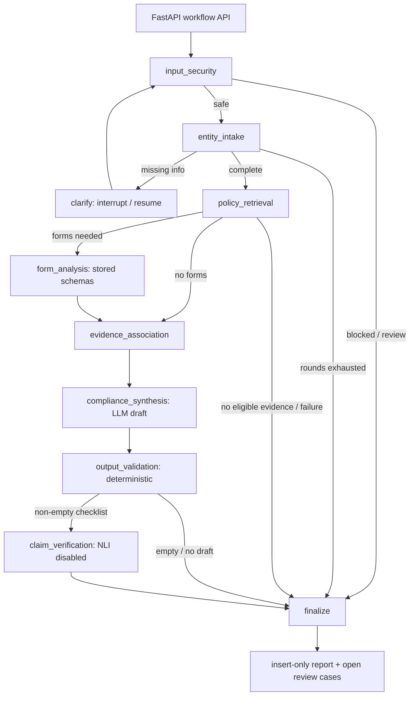

<div align="center">

# Account Opening Assistant

**A conversational assistant that tells a customer which documents and information the HDFC Bank account opening forms ask for, with a citation for every item.**

Technically, it is a KYC RAG system: retrieval-augmented answers grounded in stored, public HDFC Bank forms.


</div>

> **Disclaimer:** an independent portfolio prototype. It is **not** an HDFC Bank or RBI product and is not affiliated with or endorsed by either. It uses public HDFC documents and **synthetic data only**, does not approve, reject or assess applications, and is not production-ready. The source documents are dated; every answer advises confirming with HDFC Bank.

## What it does
- **Asks only what matters:** which account, who it is for, and only the follow-ups the applicable form needs (NRE / NRO, joint holding, minor). Chips or free text.
- **Builds a checklist from the forms:** documents to bring, details to fill in, and what could not be confirmed. Every item cites the HDFC form, page and passage it comes from; scanned text is shown as an approximate reading.
- **Says when it doesn't know:** for a combination the documents don't cover (for example a resident savings account), it gives the prescribed fallback, explains why and suggests what is covered. It never guesses.
- **Talks naturally:** answers greetings and follow-up questions, reads each message against the conversation, keeps separate accounts apart (an LLP's current account and a daughter's account are never merged) and lets the customer go back to an earlier one.
- **Remembers the conversation** across a reload or a server restart, with a rolling summary of older turns.
- **Protects data:** identifiers such as PAN or Aadhaar numbers are refused before anything is stored or sent to an LLM, and never echoed back.

## How it works
1. **Corpus:** HDFC account-opening forms ingested with PyMuPDF and Tesseract OCR, chunked into PostgreSQL and indexed in Qdrant (BGE-small). RBI documents stay stored but are excluded from the assistant.
2. **Coverage map** (`backend/app/assistant/coverage.yaml`): which category and account combinations an applicable form covers, each cell citing stored chunks.
3. **Dialogue** (`backend/app/assistant/dialogue.py`): a deterministic per-turn policy over the profile slots, with account scenarios, greetings and context handling.
4. **Checklist** (`backend/app/assistant/checklist.py`): items from the evidence catalogue, classified deterministically by source tier, citations re-resolved in PostgreSQL.
5. **Optional LLM** (Groq, behind `GROQ_LIVE_ENABLED`): extracts slot values (enum-validated) and acts as the **voice**, rewording replies from the answer's own facts. Every reply passes a deterministic check; on any failure the deterministic reply is used. The assistant works fully without an LLM.
6. **API** `/api/v2/assistant` (FastAPI) and a React frontend at `/`.

## Getting started
Requirements: Python 3.11+, Node 26, Docker.

```bash
make up          # PostgreSQL, Redis and Qdrant (infra/docker-compose.yml)
make migrate     # Alembic
make api         # FastAPI on :8000
make web         # the frontend on :5173 (open http://127.0.0.1:5173/)
```

Prerequisites (Tesseract OCR, GNU Make on Windows) and `.env` setup (`cp infra/.env.example .env`) are in the legacy *Getting started* below. The corpus is ingested with `make ingest` (see [`docs/04-ingestion-pipelines.md`](docs/04-ingestion-pipelines.md)). The live LLM is off unless `GROQ_LIVE_ENABLED=true` and a key and data-terms date are set; tests never call it.

**Checks:** `make test`, `make lint`, `make check-schema`, `make web-test`, `make web-lint`, `make web-build`, `make assistant-eval`.

## Evaluation results (A7, 2026-11-16)
The final evaluation, measured on the real stack: PostgreSQL, Qdrant, the stored HDFC corpus and the production checklist. It uses **synthetic data only** and is **deterministic** (no LLM) unless marked *live*.

**Read this first:**
- This is a prototype, **not release-ready**.
- **The 30-item human citation review has not been signed off.** Citations are verified **automatically**, not by a person.
- **Latency (fixed after A7):** the deterministic p95 missed its 750 ms target at A7 (867–948 ms). Since the catalogue titles' query vectors are stored (identical rankings on all 972 assistant searches), p95 is **389 ms**.

Full report: [`docs/assistant/A7_CLOSURE_REPORT.md`](docs/assistant/A7_CLOSURE_REPORT.md).

### Checklists, coverage and evidence
| What | Result | Target |
|---|---|---|
| Covered combinations: 55 complete profiles over 26 cells, each building a valid cited checklist | **55/55** | 100 % |
| Combinations the corpus can't establish: the exact prescribed fallback | **28/28** | 100 % |
| Resident → NRO conversion phrasings / near-misses routed correctly | **12/12** and **6/6** | 100 % |
| Citations re-resolved in PostgreSQL (document, page, exact passage, HDFC only) | **1,332/1,332** | 100 % |
| Strengthened classifications (`policy_supported`, inferred documents, organisation photos) | **0** | 0 |
| Human citation review (30 sampled items checked against the PDF pages) | **not signed off (0/30)**. The automated pre-check found the wording in the text layer for 19 rows; 1 row was not found; 10 rows are scanned pages that need a visual check | 30/30 |

### Conversation, memory and safety
| What | Result | Target |
|---|---|---|
| Scripted conversations (greetings, follow-ups, ambiguity, corrections, separate accounts, long context, off-topic and injection): 70 conversations, 241 turns | **91/91** checked turns correct | 100 % |
| Greetings that triggered a fallback or repeated the checklist | **0** of 23 | 0 |
| Memory: required facts in the LLM context / forbidden facts | **20/20** / **0** of 7 | 100 % / 0 |
| Context within budget / identical after a server restart / summary fidelity | **31/31** / **15/15** / **2/2** | 100 % |
| A deleted conversation is unrecoverable (database, summary, Redis, API) | **yes** | yes |
| Separate accounts: 200 random sequences (1,939 turns) | **0** leaks | 0 |
| Synthetic PAN / Aadhaar / passport / card / account numbers refused | **29/29** | 100 % |
| E-mail and phone redacted / harmless messages wrongly blocked | **7/7** / **0** of 15 | 100 % / 0 |
| Identifiers found in answers, the database, 140 log records or LLM requests | **0** | 0 |
| Cross-session reads / unknown ids answered 404 / id collisions in 10,000 | **0** / **20/20** / **0** | as listed |
| Idempotent replay, 409 on key reuse, 10 concurrent duplicates → 1 stored turn | **pass** | pass |
| Failure handling: store down, LLM error / 429 / timeout, expiry 410, database down 503 | **pass** | pass |
| **Deterministic latency, 500 turns** | p50 73 ms, **p95 389 ms**, p99 441 ms (stored query vectors; at A7: p95 899 ms, missed) | p95 ≤ 750 ms: **met** |

### Browser (Chrome 157, headless)
| Width | 22-step main flow | Keyboard only | Reduced motion | Layout | Console errors |
|---|---|---|---|---|---|
| 1440, 1024, 768, 390 px | **pass** at every width | **pass** (visible focus 5/5) | **pass** | no overflow at any step | **0** |

Demo video: 2 min 31 s, kept outside Git. Its SHA-256 and recording steps are in [`A7_DEMO.md`](docs/assistant/A7_DEMO.md).

### Live LLM (*live*, opt-in, Groq `openai/gpt-oss-120b`, synthetic only)
| What | Result | Target |
|---|---|---|
| Token budget (printed and enforced before the run) / used | 572,718 / 522,991 reserved; 187,424 in + 47,935 out reported by Groq | within budget |
| Voice replies accepted by the reply check, at run time | 116/119 (97 %) | ≥ 80 % (soft) |
| Factual-safety violations found by the stricter offline audit | ~48 ("you'll need …" obligation wording, plus 1 unsupported claim): **hard gate failed, check fixed** (`d7fc99b`) | 0 |
| The same replies with the fixed check | 66/119 (**55 %**), **0** violations | ≥ 80 %: **missed** |
| Turn time with the live voice | p50 2.2 s, p95 10.3 s (25 % hit the 10 s timeout) | p95 ≤ 12 s |
| Identifiers sent to the LLM / blocked messages reaching it / proposals used unconfirmed | **0** / **0** / **0** | 0 |

Every rejected or timed-out voice reply falls back to the deterministic reply, so the customer always gets the checked answer.

### Retrieval (25 HDFC-only cases, single annotator; not a gate)
| Mode | Recall@5 | Hit@5 | MRR@5 |
|---|---|---|---|
| dense (default) | 0.733 | 0.880 | 0.599 |
| BM25 | 0.613 | 0.800 | 0.653 |
| hybrid (RRF) | 0.793 | 0.920 | 0.727 |

### Observability (LangSmith)
- **Tracing:** one trace per turn with nested spans (history, context, intent, LLM, voice, retrieval, evidence): **286/286** turns, every span closed with its latency, **0** identifiers or source passages uploaded, and answers identical when LangSmith fails.
- **Live upload:** 3 synthetic turns are sent per observability run to `account-opening-assistant-eval`; the client reported no ingest error.
- **LangSmith experiment** (the 70 conversations as a dataset, with turn-accuracy evaluators): **not run**. The configured key is tracing-only (403). Run `make a7-eval SUITE=langsmith_eval` with a personal access token.
- **Tracing your own sessions:** set `ASSISTANT_TRACING=true` and `LANGSMITH_API_KEY` in `.env`. It is off by default.

### Tests and reproducibility
Final validation on this branch (A7.8, commit `f9da526` plus the closure documents):

| Check | Result |
|---|---|
| Backend unit tests (`make test`) | **2,111 passed**, 0 failed |
| Backend integration tests (`make test-integration`, real Postgres, Qdrant, Redis) | **519 passed**, 0 failed |
| Frontend tests (`make web-test`) | **197 passed** |
| `make lint` (ruff, black, mypy), `make check-schema`, `make web-lint`, typecheck, `make web-build`, `check:api` | all pass |
| A7 deterministic suites (`make a7-eval`) | all pass. At A7 closure, reliability missed only the latency target; it passes since the stored query vectors |

**Fresh-clone reproduction (A7.7):** a new clone on an isolated stack, from `requirements.lock`, `npm ci` and the owner's 9 PDFs (9/9 SHA-256 match):
- **identical results:** the same 456 chunks (ids and text), checklist item ids, 1,332 citations, conversation, memory, scenario and privacy results, and retrieval scores;
- **3 documented test differences, none of which affects the assistant's answers:**
  - a load-dependent legacy timing flake (K22);
  - 2 integration tests (one assistant provenance check, one legacy) that need a Gemini-extracted form schema a clone can't recreate without a live Gemini call (K23);
  - 2 skips that need local legacy data.

Details: [`reproducibility.md`](docs/assistant/a7/reproducibility.md).

**Reproduce:**
- `make a7-eval` (all deterministic suites);
- `make assistant-eval MODE=dense|bm25|hybrid`;
- `make a7-browser` and `make a7-demo` (need `make api` and `make web`);
- `make a7-live GROQ_LIVE_ENABLED=true` (opt-in; prints and enforces a token budget).

Reports: [`docs/assistant/a7/`](docs/assistant/a7/).

## Documentation
- **[`docs/assistant/PRODUCT_SPEC.md`](docs/assistant/PRODUCT_SPEC.md): the authoritative product specification.**
- [`docs/assistant/A5_API.md`](docs/assistant/A5_API.md): the API contract, persistence and demo.
- [`docs/assistant/A0_AUDIT.md`](docs/assistant/A0_AUDIT.md): the corpus audit and coverage matrix.
- [`docs/assistant/A7_CLOSURE_REPORT.md`](docs/assistant/A7_CLOSURE_REPORT.md): the final evaluation, its results and open limitations; the per-area reports are in [`docs/assistant/a7/`](docs/assistant/a7/), and the recorded demo in [`A7_DEMO.md`](docs/assistant/A7_DEMO.md).
- Historical stage records: A1–A4, A6 and [`REDESIGN.md`](docs/assistant/REDESIGN.md) in `docs/assistant/`.
- [`CLAUDE.md`](CLAUDE.md): the project rules.

## Project structure
```text
backend/app/assistant/   the assistant: understanding, dialogue, checklist, reply, voice, memory, API service
backend/app/api/v2/      the assistant API
frontend/src/assistant/  the assistant UI (served at /)
docs/assistant/          product specification, API reference and stage records
backend/app/graph, verification, api/v1; frontend/src/screens   the preserved legacy engine (below)
```

---

## Legacy: Agentic KYC Compliance Engine (M0–M5)
The previous product, preserved in the repository with its tests (its screens are at `/legacy`). New work does not use it; see [`CLAUDE.md`](CLAUDE.md).

> **Status at the close of M5.** The prototype ingests public RBI/HDFC KYC documents, retrieves cited evidence, runs a checkpointed LangGraph workflow and produces an insert-only report. A local web frontend (M5) drives it: Dashboard, KYC Assistant, and the Compliance Report with read-only review cases.
> - A deterministic validator checks every citation and every MANDATORY.
> - Claim-level NLI verification is built, but **disabled**: no model qualified under the pre-registered selection. Every claim is therefore reported as *not verified*, the report is labelled DEGRADED, and every item gets an open human-review case.
> - Every result requires human review. It is not production-ready and not deployed.
>
> **Handoff:** [architecture](docs/handoff/01-architecture-handoff.md) · [setup](docs/handoff/02-setup-and-reproducibility.md) · [evaluation](docs/handoff/03-evaluation-report.md) · [limitations and known issues](docs/handoff/04-limitations-and-known-issues.md) · [M5 closure report](docs/milestones/M5_CLOSURE_REPORT.md) · [M4 closure report](docs/milestones/M4_CLOSURE_REPORT.md)

### Why this exists

KYC requirements change with the customer category. An individual, an LLP and a private limited company each need different documents, declarations and authorizations. A typical document chatbot retrieves a paragraph about KYC and gives a generic answer, with no way to tell which parts are supported, conditional or simply invented.

This project connects five things that a chatbot treats separately:

1. The customer / entity type
2. The applicable regulatory provisions
3. The bank's documented requirements
4. The account-opening form
5. The evidence behind every checklist item

Its guiding rule: **a polished but wrong checklist is worse than an incomplete one that is honest about its uncertainty.** The system knows when it cannot answer.

### Key features (status at M5 close)

| | Capability | Status | What it does |
|---|---|---|---|
| 🧭 | **Intelligent intake** | operational | Extracts entity type and account type into a validated schema. Never guesses missing values. Pauses and resumes the workflow to ask enum-only clarification questions. |
| 📚 | **Policy intelligence** | operational | Structure-aware PDF ingestion (sections, tables, page references, OCR fallback) into Postgres and a metadata-filtered Qdrant index. |
| 🖼️ | **Form analysis** | operational (stored schemas); live Gemini gated off | Deterministic form schemas, plus Gemini extraction of approved public blank forms (versioned). Form fields are never policy obligations. |
| 🔎 | **Retrieval** | operational | Dense retrieval (default) with eligibility filters; BM25 and hybrid RRF selectable; reranker off by default. |
| ✅ | **Compliance synthesis + validation** | operational | An LLM drafts requirements from cited evidence. A deterministic validator re-resolves every citation in Postgres, drops uncited items and allows MANDATORY only with primary, entity-scope evidence. |
| 🛡️ | **Claim-level verification** | built; **NLI disabled** | Typed claims checked against the stored cited text by deterministic analysis plus local NLI. No NLI configuration qualified (0 of 140), so every claim is reported *not verified* and nothing is upgraded. |
| ⚖️ | **Source conflicts** | built; **not run in production** | A bounded cross-source contradiction scan with a conservative supersession rule. It needs NLI, so reports state that no automated conflict check was performed. |
| 👩‍⚖️ | **Human review cases** | operational (open, read-only) | One open case per requirement and review reason, stored with the report. Reviewer decisions (approve/reject) need authentication and are future work. |
| 🔒 | **Input screening** | operational (pattern filter) | Blocks ID/financial PII and a narrow list of override phrases. Not a prompt-injection defence; Prompt Guard is not built. |
| 📈 | **Observability** | partial | Node events over SSE, verification timings in reports. LangSmith tracing is not implemented. |
| 🖥️ | **Web frontend** | operational (local dev server) | Dashboard (API health, this tab's demo sessions), KYC Assistant (live progress, clarification, retry), Compliance Report (v1/v2) with read-only review cases. Typed from the published OpenAPI contract. No upload, no review decisions, no login. |

### How it works (as built)



The workflow is a single **LangGraph state machine**, not a swarm of free-running agents. Execution is predictable, checkpointed in Postgres, debuggable and testable. Every loop has a hard limit, and there is no regeneration loop. Outcomes are `BLOCKED`, `INSUFFICIENT_INFORMATION`, `INSUFFICIENT_EVIDENCE`, `DEGRADED` and `CHECKLIST_REVIEW_REQUIRED`. None of them approves or rejects anything.

#### Verification: what makes it different

```
Evidence : "Designated partners must be verified."
Claim    : "Every employee of the LLP must submit identity documents."
Verdict  : NEUTRAL (not supported by evidence)  ->  removed and listed for review
```

NLI alone is not treated as truth, and its scores are uncalibrated signals, not confidence. A claim counts as supported only when the model's entailment, deterministic checks (obligation wording, negation, the item named, entity scope) and the source's eligibility agree; form text never establishes an obligation. Anything unresolved goes to a human. Plan: [`docs/milestones/M4_PLAN.md`](docs/milestones/M4_PLAN.md).

**Current state:** this design is implemented and tested with a scripted scorer, but **disabled in production**. Four pinned DeBERTa-v3 checkpoints were evaluated once on the development set under a rule registered in advance, and none passed its safety gates (0 of 140 configurations). So every claim is reported *not verified* rather than trusting an unqualified model. See the [evaluation report](docs/handoff/03-evaluation-report.md).

### Tech stack

| Layer | Technology |
|---|---|
| Frontend | React, Vite, Tailwind CSS, TypeScript, React Router, React Query (M5; types generated from `docs/api/openapi.json`; Node 26.13.1) |
| Backend | Python, FastAPI, Pydantic v2, SQLAlchemy, Alembic |
| Orchestration | LangGraph with Postgres checkpointing |
| LLMs | Groq-hosted open models (reasoning), Gemini (multimodal forms), behind a provider-agnostic interface |
| Retrieval | Qdrant, BGE-small embeddings, BM25, RRF |
| Verification | Deterministic statement analysis; DeBERTa-v3 NLI scorer (local; built, disabled: no checkpoint qualified) |
| Security | Deterministic input screening and output validation (Prompt Guard planned, not built) |
| Data | PostgreSQL (corpus, form schemas, workflow, checkpoints, reports, review cases), Redis (form-schema cache, rate limiter, SSE wake-up) |
| Observability | SSE node events and run status (LangSmith planned, not implemented) |
| PDF processing | PyMuPDF, Tesseract OCR fallback |

Everything runs locally through Docker and fits on free tiers for a public demo. Details in [`docs/02-tech-stack-free-tier.md`](docs/02-tech-stack-free-tier.md).

### Getting started

**Prerequisites:** Docker, Python 3.11+, GNU Make, [Tesseract OCR](https://github.com/tesseract-ocr/tesseract) 5.x (OCR fallback for scanned pages), and optionally free API keys for Groq and Google AI Studio (only for the opt-in live runs; **no API key is needed for ingestion, retrieval, the workflow without a live LLM, or any test**). For the frontend (M5): Node.js **26.13.1 LTS** (exact major enforced by `frontend/package.json`; installed here with NVM for Windows). On Windows: `winget install ezwinports.make` and `winget install UB-Mannheim.TesseractOCR`. Tesseract is found via `TESSERACT_CMD`, then `PATH`, then the standard install folder (`C:\Program Files\Tesseract-OCR\`), so a default winget install needs no configuration. For a non-standard location, set `TESSERACT_CMD=D:/path/to/tesseract.exe` (and optionally `TESSDATA_DIR`) in a **repo-root `.env`**. `.env` is gitignored and machine-specific: never commit it, and never put machine paths in `infra/.env.example`.

```bash
# 1. Clone and configure
git clone <your-repo-url> && cd agentic-kyc-compliance-engine
cp infra/.env.example .env          # optional for M1; .env overrides infra/.env.example
make venv install                   # .venv + backend with dev tools
#   or: make venv install-locked     # exact tested versions (backend/requirements.lock)

# 2. Start Postgres (host port 5433), Redis and Qdrant, then create the schema
make up
make migrate                        # Alembic 0001-0009 (M1 corpus, M2 form schemas, M3 workflow + checkpointer, M4 review cases, A5 assistant)
make check-schema                   # ORM models == migrations (no drift)

# 3. Add the source PDFs (not in Git; see docs/14-source-corpus.md) and check them
#    data/raw_pdfs/{regulatory,policy,forms,reference}/*.pdf, listed in data/raw_pdfs/manifest.yaml
make check-corpus                   # manifest + SHA-256 of every PDF + Tesseract smoke test

# 4. Ingest: validate -> extract -> OCR -> chunk -> Postgres -> embed (BGE-small,
#    ~135 MB download on first run) -> Qdrant -> integrity + Postgres/Qdrant reconciliation
make ingest-dry                     # optional: what would change; writes nothing
make ingest                         # all documents; or: make ingest DOC="rbi_kyc_faqs"
make search Q="documents for opening an account of a partnership firm"
make eval                           # Recall@5 on data/eval/m1_retrieval.jsonl

# 5. Form schemas (M2). Deterministic, from the stored chunks; no API key:
make forms                          # 6 schemas; a second run reports "unchanged"
#    Optional Gemini extraction of the 5 approved public BLANK forms only
#    (data/raw_pdfs/forms_approved.yaml). Live calls are off unless you opt in:
#    set GEMINI_API_KEY, GEMINI_LIVE_ENABLED=true, GEMINI_DATA_TERMS_VERIFIED_ON=<date you
#    reviewed the Gemini API terms> and MULTIMODAL_FALLBACK_MODEL in .env (docs/02), then:
#    cd backend && python -m app.ingestion.cli forms extract --provider gemini
cd backend && python -m app.ingestion.cli forms versions && cd ..   # stored versions per form
cd backend && python -m app.ingestion.cli forms show hdfc_nri_account_opening --method gemini_multimodal && cd ..   # read through the Redis cache ("cache: hit|miss")

# 6. Backend: health and the M3 workflow API (synthetic data only)
make api                            # http://localhost:8000/docs, health at /api/v1/health
#    POST /api/v1/sessions -> POST /api/v1/sessions/{id}/messages (Idempotency-Key header)
#    -> GET /api/v1/sessions/{id} (clarification questions + checkpoint_id)
#    -> POST .../resume -> GET /api/v1/reports/{report_id}. See docs/07.
#    GET /api/v1/sessions/{id}/events streams progress (SSE; open it before the message).
#    Without Groq live calls enabled, intake asks every question and the report is DEGRADED.

# 6b. Frontend (Node 26.13.1): the Account Opening Assistant at / (the M5 Dashboard, KYC
#     Assistant and Compliance Report are preserved under /legacy). Needs `make api` running.
make web-install                    # npm ci from frontend/package-lock.json (no install scripts)
make web                            # http://127.0.0.1:5173/ ; /api is proxied to `make api`
make web-test web-lint              # Vitest; type-check + ESLint + Prettier + API types up to date

# 7. The M3 LLP demo through the running API (a second terminal; synthetic question only)
make demo                           # whatever LLM the API runs with; prints events + report + verdict
#    Live Groq (opt-in): set GROQ_LIVE_ENABLED=true and GROQ_DATA_TERMS_VERIFIED_ON=<the date
#    you reviewed Groq's terms> in .env (docs/02), restart `make api`, then:
make demo-live                      # refuses unless the gate is open; set the gate back to false after

# 8. Retention (M3): phase 1 at session expiry, phase 2 after REPORT_RETENTION_D days
make purge-dry                      # what would be deleted; writes nothing
make purge                          # checkpoints + idempotency rows, then expired sessions
make check-workflow                 # read-only: orphan checkpoint data, residue, pending purges
```

Ingestion is idempotent: running `make ingest` again writes nothing and embeds nothing unless a source changed. If a document fails, it is reported with the failing stage and is never marked `completed`. Fix the cause, then `make retry`. See [Ingestion operations](#ingestion-operations-m1) below.

#### Form schemas (M2)

| Command (`cd backend && python -m app.ingestion.cli …`) | What it does |
|---|---|
| `forms extract [--document KEY]…` (`make forms`) | Deterministic schemas from stored M1 chunks (default provider); idempotent, never overwrites |
| `forms extract --provider gemini [--document KEY]…` | Gemini multimodal extraction of **approved public blank forms only**. Live-gated. 5 attempts with 2→4→8→16 s backoff, then the fallback model. RECITATION refusals → local OCR for human review. A stored version makes zero calls |
| `forms list` / `forms versions` | Stored schemas / per approved form, which (method, version) rows actually exist |
| `forms show KEY [--method m1_chunks\|gemini_multimodal] [--version N] [--json]` | One stored schema with page and chunk citations, read through the Redis cache (Postgres is the source of truth) |

Form fields show what a blank form **asks for** (`appears_on_form`). They are never policy obligations: `mandatory_under_policy` is always empty and the database rejects any other value. Full reference: [`docs/04`](docs/04-ingestion-pipelines.md), [`docs/milestones/M2_HANDOFF.md`](docs/milestones/M2_HANDOFF.md).

Other targets: `make test` (unit), `make test-integration` (needs `make up`), `make lint`, `make fmt`, `make down`. `make` alone prints the list of targets. The Makefile works from PowerShell/CMD on Windows (GNU Make then runs recipes with `cmd.exe`), Git Bash, Linux and macOS; repo paths with spaces are fine. Without Make, run the command behind each target from `backend/`; for example, `make ingest` is `python -m app.ingestion.cli run` using the venv interpreter (`..\.venv\Scripts\python.exe` on Windows, `../.venv/bin/python` elsewhere).

> Postgres is mapped to host port **5433** so it doesn't clash with a native Postgres install on 5432.

> Use only public, authorized or synthetic documents. Check each external API's data-use terms before uploading anything confidential.

#### Ingestion operations (M1)

| Make target | CLI (`cd backend && python -m app.ingestion.cli …`) | What it does |
|---|---|---|
| `make ingest [DOC=…]` | `run [--document KEY]… [--path DIR] [--force]` (alias `ingest`) | Full workflow, per document, then verification |
| `make ingest-dry` | `run --dry-run` | Stages A–C; the Postgres write is rolled back; Qdrant is compared read-only |
| `make persist` | `persist` | Stages A–C + Postgres only; documents stay `pending` |
| `make index` | `index --from-db` | Embed and index from committed Postgres rows (no PDF read) |
| `make retry` | `retry` | One recovery attempt per document that is not `completed`/`partial` |
| `make reconcile` | `reconcile` | Postgres ↔ Qdrant in both directions; read-only |
| `make repair` | `reconcile --repair [--delete-unknown]` | Re-index inconsistent documents from Postgres |
| `make runs` | `runs [--document KEY] [--failed]` | Ingestion history with the failing stage and error |
| `make search Q=… [MODE=…]` | `search QUERY [--top-k] [--entity] [--bank] [--mandatory-only] [--expand] [--mode dense\|bm25\|hybrid] [--rerank]` | Top-5 passages with document + page citations (M2: dense, BM25 and hybrid modes; default `dense`; `--mode hybrid` = the A3-selected C6, experimental; `--rerank` = optional cross-encoder reranking, off by default) |
| `make eval [MODE=…]` | `evaluate [--dataset] [--report] [--mode …]` | Recall@5 / Hit@5 / MRR on the development set (the frozen held-out set is refused) |
| `make eval-compare` | `evaluate --compare` | Dense vs BM25 vs hybrid on the development set, with latency (selects nothing) |
| `make check-dense-golden` | — | M1 dense regression against the golden snapshot (fails, never skips) |
| `make check-corpus` | `validate-manifest`, `check-ocr` | Manifest + PDF hashes; Tesseract smoke test |

`index` without `--from-db` is the Stage D in-memory indexer (Stages A–C → Qdrant, no Postgres), kept for experiments. Exit codes: `0` ok, `1` a document failed or the stores are inconsistent, `2` invalid input or a service not ready (nothing written). Full reference: [`docs/04-ingestion-pipelines.md`](docs/04-ingestion-pipelines.md); M1 handoff: [`docs/milestones/M1_HANDOFF.md`](docs/milestones/M1_HANDOFF.md).

### Project structure

```
backend/app/
  api/v1/          REST + SSE endpoints
  graph/           LangGraph state, routing, nodes, reports, review cases
  ingestion/       policy and form pipelines (CLI)
  forms/           form-schema helpers
  retrieval/       embeddings, Qdrant, BM25, fusion, reranker, evaluation
  verification/    claims, premises, statement analysis, decision table, NLI, conflicts
  security/        deterministic input screening
  workflow/        API service, retention, acceptance checker, demo
  db/              models and repositories
  llm/             provider interface + Groq / Gemini adapters
  rules/           empty (a rules layer is not built)
backend/alembic/   migrations 0001-0008
frontend/          React + Vite + TypeScript app (M5): Dashboard, KYC Assistant, Compliance Report;
                   src/api (typed client, SSE), src/screens, src/storage (sessionStorage)
docs/api/          the published OpenAPI contract (make openapi)
data/eval/         evaluation datasets and committed evaluation records
eval/              one M2 diagnostic script
infra/             docker-compose and env template (no secrets)
docs/              specification, milestone records and the handoff (docs/handoff/)
```

### Evaluation

Quality is measured, not assumed; full results are in [`docs/handoff/03-evaluation-report.md`](docs/handoff/03-evaluation-report.md).
- **Retrieval (M1/M2):** dense Recall@5 0.825 on the 20-query development set and 0.900 on the frozen 20-query held-out set; hybrid did not beat dense, so dense stays the default.
- **Claim verification (M4):**
  - the registered NLI selection on 55 owner-reviewed development cases qualified **0 of 140** configurations (every one failed the MANDATORY false-positive gate), so NLI is disabled;
  - the M4 held-out claim set is **frozen and unused** (SHA-256 `eee0a575…d90203`), because there is no selected model to estimate.
- **Latency (NLI off, real corpus):** verification step p50 47 ms; whole run p50 ≈ 0.5 s with a scripted LLM.
- **Not yet built:** the planned 50-case end-to-end benchmark (M6).

**M1 retrieval baseline (measured 2026-11-08):** dense BGE-small search with the default eligibility filters, on 20 hand-labelled queries (28 target passages, `data/eval/m1_retrieval.jsonl`): mean **Recall@5 0.825**, **Hit@5 0.90**, **MRR@5 0.775**. It is a small, single-annotator set. **M2:** BM25 and hybrid (RRF) retrieval were implemented and evaluated against this baseline (development and frozen held-out sets). Hybrid did not beat dense by the pre-registered margin, so **dense stays the default** and hybrid is selectable (`--mode hybrid`); see [`docs/10`](docs/10-evaluation-plan.md). Full results from the 50-case benchmark will be published when available.

### Security and privacy

- Retrieved document text is **untrusted evidence**, delimited in prompts and never followed as instructions
- The workflow makes no tool calls: no code execution, file access or arbitrary network calls from the LLM
- User text is screened before it is stored: ID and financial identifiers are blocked, contact details redacted (a pattern filter, not a guarantee)
- Live Groq and Gemini calls are off by default and gated on a recorded data-terms review; Gemini is limited to approved public blank forms and is never called by the workflow
- A shared rate limiter bounds LLM calls; there is no document-upload endpoint and no user authentication (session id possession)
- Synthetic customer data only; no secrets or PII in logs, state or reports

### Limitations

This system does **not** approve or reject applications, verify identity against government databases, validate real PAN/Aadhaar records, make legal or regulatory decisions, guarantee compliance, or access any bank's internal systems. Output is decision support that requires human review.

M5 limits (frontend; details in [`docs/milestones/M5_CLOSURE_REPORT.md`](docs/milestones/M5_CLOSURE_REPORT.md)):
- Local development server only; no production deployment and no authentication (whoever holds a session or report id can open it).
- Session ids are kept in the browser tab's `sessionStorage`: they survive reloads and are gone when the tab closes. The Dashboard lists only this tab's sessions.
- The report shows document keys and page ranges but no source text (the API returns none); page references are not re-checked (K5).
- A run left stuck by a server crash is not offered a retry in the UI (only failed runs are).
- Review cases are read-only; there is no review-decision workflow.

M2-specific limits:
- Retrieval quality is measured on 20-query single-annotator sets only.
- Gemini form extraction runs on the free tier, so it is restricted to public blank forms. Its field labels are corroborated against stored page text, not verified for accuracy.
- Two forms have only v1 Gemini records.
- The RECITATION→OCR fallback is tested but has not yet occurred live.
- Details: [`docs/milestones/M2_HANDOFF.md`](docs/milestones/M2_HANDOFF.md).

M4 limits (full register: [`docs/handoff/04-limitations-and-known-issues.md`](docs/handoff/04-limitations-and-known-issues.md)):
- NLI semantic verification is disabled (no configuration qualified), so claims are *not verified* and reports with a checklist are DEGRADED.
- The automated conflict scan does not run in production.
- Review cases are open and read-only; there is no decision workflow and no authentication.
- Known issues include deferred verification-rule defects, a pre-existing citation page-range mismatch for child chunks, and three environment-dependent test failures (K7, K7b and K8, all fixed in A7.5: see [`docs/assistant/a7/known_failures.md`](docs/assistant/a7/known_failures.md)).

M3 limits:
- The workflow drafts a checklist only from retrieved, cited sources, and a deterministic validator checks every citation and every MANDATORY.
- On the thin LLP evidence in the corpus, the honest result is a short CONDITIONAL checklist with unresolved items; the live Groq demo proposed two MANDATORY items and the validator downgraded both (only supporting-form evidence).
- Crashed runs are recovered explicitly (`POST /retry`), never automatically. Run-status SSE events are current status only.
- When the knowledge base does not support an answer, it says so and refers you to HDFC Bank. It never treats missing evidence as "not required".
- Explanations are model-drafted and not claim-verified. The M4 verification step is wired into the workflow, but no NLI model qualified in the S4 selection, so it runs disabled: every claim is marked not verified, nothing is shown as MANDATORY, and the result is labelled DEGRADED.
- Every result requires human review.
- Details: [`docs/milestones/M3_HANDOFF.md`](docs/milestones/M3_HANDOFF.md).

### Roadmap

- [x] Document ingestion and retrieval foundation (M1: see [`docs/milestones/M1_HANDOFF.md`](docs/milestones/M1_HANDOFF.md))
- [x] Hybrid retrieval and multimodal form extraction (M2: see [`docs/milestones/M2_HANDOFF.md`](docs/milestones/M2_HANDOFF.md))
- [x] End-to-end LangGraph workflow (M3: see [`docs/milestones/M3_HANDOFF.md`](docs/milestones/M3_HANDOFF.md))
- [x] Claim verification infrastructure and review cases (M4: NLI built but disabled, no model qualified; see [`docs/milestones/M4_CLOSURE_REPORT.md`](docs/milestones/M4_CLOSURE_REPORT.md))
- [x] Web frontend: Dashboard, KYC Assistant, Compliance Report with read-only review cases (M5: see [`docs/milestones/M5_CLOSURE_REPORT.md`](docs/milestones/M5_CLOSURE_REPORT.md))
- [ ] Future security milestone — number TBD: Prompt Guard, rules layer, adversarial suite, reviewer decisions with authentication (per M4 decision D1)
- [ ] Evaluation benchmark and observability (M6; also Document Intelligence and Observability screens, moved from M5)
- [ ] Deployment and demo

### Documentation

| Topic | File |
|---|---|
| Overview and scope | [`docs/00-project-overview.md`](docs/00-project-overview.md) |
| Architecture | [`docs/01-architecture.md`](docs/01-architecture.md) |
| Tech stack and free-tier plan | [`docs/02-tech-stack-free-tier.md`](docs/02-tech-stack-free-tier.md) |
| LangGraph design | [`docs/03-langgraph-design.md`](docs/03-langgraph-design.md) |
| Ingestion pipelines | [`docs/04-ingestion-pipelines.md`](docs/04-ingestion-pipelines.md) |
| Source corpus and data layout | [`docs/14-source-corpus.md`](docs/14-source-corpus.md) |
| Canonical vocabularies (entity types, statuses, eligibility) | [`docs/15-taxonomy.md`](docs/15-taxonomy.md) |
| Rules and verification | [`docs/05-rules-and-verification.md`](docs/05-rules-and-verification.md) |
| Security | [`docs/06-security-guardrails.md`](docs/06-security-guardrails.md) |
| API design | [`docs/07-api-design.md`](docs/07-api-design.md) |
| Data model | [`docs/08-data-model.md`](docs/08-data-model.md) |
| Frontend | [`docs/09-frontend-spec.md`](docs/09-frontend-spec.md) |
| Evaluation | [`docs/10-evaluation-plan.md`](docs/10-evaluation-plan.md) |
| Observability and reliability | [`docs/11-observability-and-reliability.md`](docs/11-observability-and-reliability.md) |
| **Handoff: architecture (as built)** | [`docs/handoff/01-architecture-handoff.md`](docs/handoff/01-architecture-handoff.md) |
| **Handoff: setup and reproducibility** | [`docs/handoff/02-setup-and-reproducibility.md`](docs/handoff/02-setup-and-reproducibility.md) |
| **Handoff: evaluation report** | [`docs/handoff/03-evaluation-report.md`](docs/handoff/03-evaluation-report.md) |
| **Handoff: limitations and known issues** | [`docs/handoff/04-limitations-and-known-issues.md`](docs/handoff/04-limitations-and-known-issues.md) |
| **M4 closure report** | [`docs/milestones/M4_CLOSURE_REPORT.md`](docs/milestones/M4_CLOSURE_REPORT.md) |
| **M5 plan and closure (frontend)** | [`docs/milestones/M5_PLAN.md`](docs/milestones/M5_PLAN.md), [`docs/milestones/M5_CLOSURE_REPORT.md`](docs/milestones/M5_CLOSURE_REPORT.md) |
| Published API contract | [`docs/api/openapi.json`](docs/api/openapi.json) |
| **Account Opening Assistant** (spec, API, interface, design system) | [`docs/assistant/PRODUCT_SPEC.md`](docs/assistant/PRODUCT_SPEC.md), [`docs/assistant/A5_API.md`](docs/assistant/A5_API.md), [`docs/assistant/A6_UI.md`](docs/assistant/A6_UI.md), [`docs/assistant/REDESIGN.md`](docs/assistant/REDESIGN.md) |

### License

No license has been chosen for this repository yet.

**Third-party licence notice.** PDF extraction uses [PyMuPDF](https://pymupdf.readthedocs.io/) (with `pymupdf4llm`), which is licensed under the **GNU AGPL-3.0** or a commercial licence from Artifex. Whatever licence you pick for this project's own code, distributing it together with PyMuPDF, or running it as a network service, triggers AGPL-3.0 obligations (offering the corresponding source), unless you buy a commercial licence. Details and the other dependency licences are in [`docs/02-tech-stack-free-tier.md`](docs/02-tech-stack-free-tier.md#dependency-pins-and-licences).
