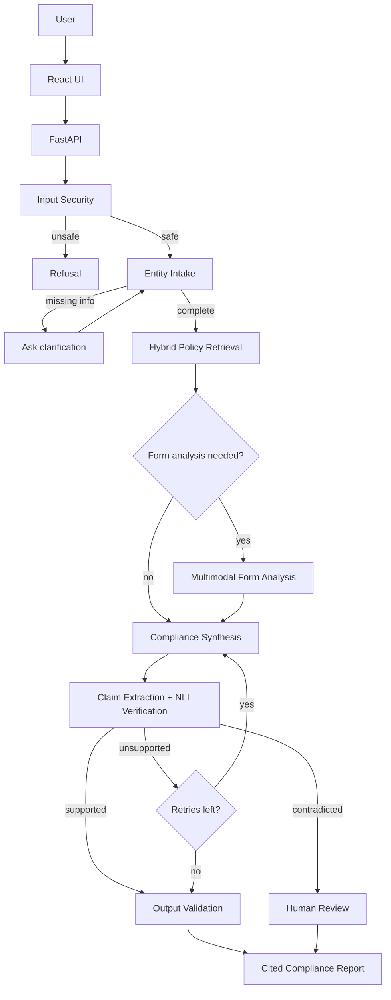

<div align="center">

# Agentic KYC Compliance Engine

**An evidence-grounded, multimodal RAG system that turns KYC policies and account-opening forms into verified, citation-backed compliance checklists.**


</div>

> **Disclaimer:** This is an independent portfolio prototype built on authorized or illustrative documents. It is **not** an official HDFC Bank product, does not approve or reject real applications, and does not replace a bank's compliance team.

---

## Why this exists

KYC requirements change with the customer category. An individual, an LLP and a private limited company each need different documents, declarations and authorizations. A typical document chatbot retrieves a paragraph about KYC and gives a generic answer, with no way to tell which parts are supported, conditional or simply invented.

This project connects five things that a chatbot treats separately:

1. The customer / entity type
2. The applicable regulatory provisions
3. The bank's documented requirements
4. The account-opening form
5. The evidence behind every checklist item

Its guiding rule: **a polished but wrong checklist is worse than an incomplete one that is honest about its uncertainty.** The system knows when it cannot answer.

## Key features

| | Capability | What it does |
|---|---|---|
| 🧭 | **Intelligent intake** | Extracts entity type, account type and facts into a validated schema. Never guesses missing values. Pauses and resumes the workflow to ask targeted questions. |
| 📚 | **Policy intelligence** | Structure-aware PDF ingestion (sections, tables, page references, OCR fallback) into a metadata-filtered vector store. |
| 🖼️ | **Multimodal form analysis** | A vision-capable model extracts fields, checkboxes, signature blocks, declarations and annexures into validated, versioned JSON. |
| 🔎 | **Hybrid retrieval** | Entity-aware metadata filtering, dense embeddings and BM25, fused with Reciprocal Rank Fusion. |
| ✅ | **Compliance synthesis** | Requirements labelled **Mandatory / Conditional / Optional / Unclear**, each with an explanation, source document and page. |
| 🛡️ | **Claim-level verification** (M4, in progress; NLI disabled: no model qualified on the dev set) | Typed atomic claims checked against the stored cited text with a local NLI model and deterministic obligation/negation rules. Unsupported claims are removed from the checklist and listed for review; nothing is upgraded. |
| 🔒 | **Security guardrails** | Prompt-injection detection, untrusted-evidence handling, output validation and least-privilege agent tools. |
| 👩‍⚖️ | **Human-in-the-loop review** | Conflicts and low-confidence items become review cases that a person approves, rejects or leaves unresolved, with a recorded reason. |
| 📈 | **Observability** | Node-level traces, latency, retries and verification outcomes, in LangSmith and in an in-app view. |

## How it works



The workflow is a single **LangGraph state machine**, not a swarm of free-running agents. Execution is predictable, checkpointed, debuggable and testable. Every loop has a hard limit.

### Verification: what makes it different

```
Evidence : "Designated partners must be verified."
Claim    : "Every employee of the LLP must submit identity documents."
Verdict  : NEUTRAL (not supported by evidence)  ->  removed and listed for review
```

NLI alone is not treated as truth, and its scores are uncalibrated signals, not confidence. A claim counts as supported only when the model's entailment, deterministic checks (obligation wording, negation, the item named, entity scope) and the source's eligibility agree; form text never establishes an obligation. Anything unresolved goes to a human. Plan: [`docs/milestones/M4_PLAN.md`](docs/milestones/M4_PLAN.md).

## Tech stack

| Layer | Technology |
|---|---|
| Frontend | React, Vite, Tailwind CSS |
| Backend | Python, FastAPI, Pydantic v2, SQLAlchemy, Alembic |
| Orchestration | LangGraph with Postgres checkpointing |
| LLMs | Groq-hosted open models (reasoning), Gemini (multimodal forms), behind a provider-agnostic interface |
| Retrieval | Qdrant, BGE-small embeddings, BM25, RRF |
| Verification | DeBERTa-v3 NLI (runs locally) |
| Security | Prompt Guard 2 plus deterministic validation |
| Data | PostgreSQL (state, reports, claims, rules), Redis (cache, rate limits, pub/sub, queue) |
| Observability | LangSmith |
| PDF processing | PyMuPDF, Tesseract OCR fallback |

Everything runs locally through Docker and fits on free tiers for a public demo. Details in [`docs/02-tech-stack-free-tier.md`](docs/02-tech-stack-free-tier.md).

## Getting started

**Prerequisites:** Docker, Python 3.11+, GNU Make, [Tesseract OCR](https://github.com/tesseract-ocr/tesseract) 5.x (OCR fallback for scanned pages), Node 18+ (frontend, from M5), and free API keys for Groq, Google AI Studio and (optionally) LangSmith (from M2/M3; **M1 needs no API key**). On Windows: `winget install ezwinports.make` and `winget install UB-Mannheim.TesseractOCR`. Tesseract is found via `TESSERACT_CMD`, then `PATH`, then the standard install folder (`C:\Program Files\Tesseract-OCR\`), so a default winget install needs no configuration. For a non-standard location, set `TESSERACT_CMD=D:/path/to/tesseract.exe` (and optionally `TESSDATA_DIR`) in a **repo-root `.env`**. `.env` is gitignored and machine-specific: never commit it, and never put machine paths in `infra/.env.example`.

```bash
# 1. Clone and configure
git clone <your-repo-url> && cd agentic-kyc-compliance-engine
cp infra/.env.example .env          # optional for M1; .env overrides infra/.env.example
make venv install                   # .venv + backend with dev tools
#   or: make venv install-locked     # exact tested versions (backend/requirements.lock)

# 2. Start Postgres (host port 5433), Redis and Qdrant, then create the schema
make up
make migrate                        # Alembic 0001-0007 (M1 corpus, M2 form schemas, M3 workflow + checkpointer)
make check-schema                   # ORM models == migrations (no drift)

# 3. Add the source PDFs (not in Git; see docs/14-source-corpus.md) and check them
#    data/raw_pdfs/{regulatory,policy,forms,reference}/*.pdf, listed in data/raw_pdfs/manifest.yaml
make check-corpus                   # manifest + SHA-256 of every PDF + Tesseract smoke test

# 4. Ingest: validate -> extract -> OCR -> chunk -> Postgres -> embed (BGE-small,
#    ~135 MB download on first run) -> Qdrant -> integrity + Postgres/Qdrant reconciliation
make ingest-dry                     # optional: what would change; writes nothing
make ingest                         # all documents; or: make ingest DOC="rbi_kyc_faqs"
make search Q="documents for opening an account of a partnership firm"
make eval                           # Recall@5 on data/eval/m1_retrieval.jsonl

# 5. Form schemas (M2). Deterministic, from the stored chunks; no API key:
make forms                          # 6 schemas; a second run reports "unchanged"
#    Optional Gemini extraction of the 5 approved public BLANK forms only
#    (data/raw_pdfs/forms_approved.yaml). Live calls are off unless you opt in:
#    set GEMINI_API_KEY, GEMINI_LIVE_ENABLED=true, GEMINI_DATA_TERMS_VERIFIED_ON=<date you
#    reviewed the Gemini API terms> and MULTIMODAL_FALLBACK_MODEL in .env (docs/02), then:
#    cd backend && python -m app.ingestion.cli forms extract --provider gemini
cd backend && python -m app.ingestion.cli forms versions && cd ..   # stored versions per form
cd backend && python -m app.ingestion.cli forms show hdfc_nri_account_opening --method gemini_multimodal && cd ..   # read through the Redis cache ("cache: hit|miss")

# 6. Backend: health and the M3 workflow API (synthetic data only)
make api                            # http://localhost:8000/docs, health at /api/v1/health
#    POST /api/v1/sessions -> POST /api/v1/sessions/{id}/messages (Idempotency-Key header)
#    -> GET /api/v1/sessions/{id} (clarification questions + checkpoint_id)
#    -> POST .../resume -> GET /api/v1/reports/{report_id}. See docs/07.
#    GET /api/v1/sessions/{id}/events streams progress (SSE; open it before the message).
#    Without Groq live calls enabled, intake asks every question and the report is DEGRADED.

# 7. The M3 LLP demo through the running API (a second terminal; synthetic question only)
make demo                           # whatever LLM the API runs with; prints events + report + verdict
#    Live Groq (opt-in): set GROQ_LIVE_ENABLED=true and GROQ_DATA_TERMS_VERIFIED_ON=<the date
#    you reviewed Groq's terms> in .env (docs/02), restart `make api`, then:
make demo-live                      # refuses unless the gate is open; set the gate back to false after

# 8. Retention (M3): phase 1 at session expiry, phase 2 after REPORT_RETENTION_D days
make purge-dry                      # what would be deleted; writes nothing
make purge                          # checkpoints + idempotency rows, then expired sessions
make check-workflow                 # read-only: orphan checkpoint data, residue, pending purges
```

Ingestion is idempotent: running `make ingest` again writes nothing and embeds nothing unless a source changed. If a document fails, it is reported with the failing stage and is never marked `completed`. Fix the cause, then `make retry`. See [Ingestion operations](#ingestion-operations-m1) below.

### Form schemas (M2)

| Command (`cd backend && python -m app.ingestion.cli …`) | What it does |
|---|---|
| `forms extract [--document KEY]…` (`make forms`) | Deterministic schemas from stored M1 chunks (default provider); idempotent, never overwrites |
| `forms extract --provider gemini [--document KEY]…` | Gemini multimodal extraction of **approved public blank forms only**. Live-gated. 5 attempts with 2→4→8→16 s backoff, then the fallback model. RECITATION refusals → local OCR for human review. A stored version makes zero calls |
| `forms list` / `forms versions` | Stored schemas / per approved form, which (method, version) rows actually exist |
| `forms show KEY [--method m1_chunks\|gemini_multimodal] [--version N] [--json]` | One stored schema with page and chunk citations, read through the Redis cache (Postgres is the source of truth) |

Form fields show what a blank form **asks for** (`appears_on_form`). They are never policy obligations: `mandatory_under_policy` is always empty and the database rejects any other value. Full reference: [`docs/04`](docs/04-ingestion-pipelines.md), [`docs/milestones/M2_HANDOFF.md`](docs/milestones/M2_HANDOFF.md).

Other targets: `make test` (unit), `make test-integration` (needs `make up`), `make lint`, `make fmt`, `make down`. `make` alone prints the list of targets. The Makefile works from PowerShell/CMD on Windows (GNU Make then runs recipes with `cmd.exe`), Git Bash, Linux and macOS; repo paths with spaces are fine. Without Make, run the command behind each target from `backend/`; for example, `make ingest` is `python -m app.ingestion.cli run` using the venv interpreter (`..\.venv\Scripts\python.exe` on Windows, `../.venv/bin/python` elsewhere).

> Postgres is mapped to host port **5433** so it doesn't clash with a native Postgres install on 5432.

> Use only public, authorized or synthetic documents. Check each external API's data-use terms before uploading anything confidential.

### Ingestion operations (M1)

| Make target | CLI (`cd backend && python -m app.ingestion.cli …`) | What it does |
|---|---|---|
| `make ingest [DOC=…]` | `run [--document KEY]… [--path DIR] [--force]` (alias `ingest`) | Full workflow, per document, then verification |
| `make ingest-dry` | `run --dry-run` | Stages A–C; the Postgres write is rolled back; Qdrant is compared read-only |
| `make persist` | `persist` | Stages A–C + Postgres only; documents stay `pending` |
| `make index` | `index --from-db` | Embed and index from committed Postgres rows (no PDF read) |
| `make retry` | `retry` | One recovery attempt per document that is not `completed`/`partial` |
| `make reconcile` | `reconcile` | Postgres ↔ Qdrant in both directions; read-only |
| `make repair` | `reconcile --repair [--delete-unknown]` | Re-index inconsistent documents from Postgres |
| `make runs` | `runs [--document KEY] [--failed]` | Ingestion history with the failing stage and error |
| `make search Q=… [MODE=…]` | `search QUERY [--top-k] [--entity] [--bank] [--mandatory-only] [--expand] [--mode dense\|bm25\|hybrid] [--rerank]` | Top-5 passages with document + page citations (M2: dense, BM25 and hybrid modes; default `dense`; `--mode hybrid` = the A3-selected C6, experimental; `--rerank` = optional cross-encoder reranking, off by default) |
| `make eval [MODE=…]` | `evaluate [--dataset] [--report] [--mode …]` | Recall@5 / Hit@5 / MRR on the development set (the frozen held-out set is refused) |
| `make eval-compare` | `evaluate --compare` | Dense vs BM25 vs hybrid on the development set, with latency (selects nothing) |
| `make check-dense-golden` | — | M1 dense regression against the golden snapshot (fails, never skips) |
| `make check-corpus` | `validate-manifest`, `check-ocr` | Manifest + PDF hashes; Tesseract smoke test |

`index` without `--from-db` is the Stage D in-memory indexer (Stages A–C → Qdrant, no Postgres), kept for experiments. Exit codes: `0` ok, `1` a document failed or the stores are inconsistent, `2` invalid input or a service not ready (nothing written). Full reference: [`docs/04-ingestion-pipelines.md`](docs/04-ingestion-pipelines.md); M1 handoff: [`docs/milestones/M1_HANDOFF.md`](docs/milestones/M1_HANDOFF.md).

## Project structure

```
backend/app/
  api/v1/          REST + SSE endpoints
  graph/           LangGraph state, routing, nodes
  ingestion/       policy and form pipelines
  retrieval/       embeddings, Qdrant, BM25, fusion
  verification/    claim extraction, NLI, scoring
  security/        guardrails and validators
  rules/           deterministic applicability rules
  llm/             provider interface + Groq / Gemini adapters
frontend/          React dashboard (5 screens + review queue)
data/eval/         benchmark datasets
eval/              metrics and ablation runners
infra/             docker-compose and env template
docs/              full specification
```

## Evaluation

Quality is measured, not assumed. The plan includes a 50-case benchmark (expanding to 100+) covering entity-specific questions, missing information, classification, prompt injection, contradictory claims and form interpretation.

**Metrics:** Recall@5 · citation precision · unsupported-claim rate · claim-verification precision/recall · entity-classification accuracy · form-extraction accuracy · security attack success rate · latency and token usage.

**Ablations:** plain RAG -> + metadata filtering -> + hybrid retrieval -> + claim-level NLI -> full pipeline. The full pipeline is not assumed to win; the benchmark decides.

**M1 retrieval baseline (measured 2026-11-08):** dense BGE-small search with the default eligibility filters, on 20 hand-labelled queries (28 target passages, `data/eval/m1_retrieval.jsonl`): mean **Recall@5 0.825**, **Hit@5 0.90**, **MRR@5 0.775**. It is a small, single-annotator set. **M2:** BM25 and hybrid (RRF) retrieval were implemented and evaluated against this baseline (development and frozen held-out sets). Hybrid did not beat dense by the pre-registered margin, so **dense stays the default** and hybrid is selectable (`--mode hybrid`); see [`docs/10`](docs/10-evaluation-plan.md). Full results from the 50-case benchmark will be published when available.

## Security and privacy

- Retrieved document text is **untrusted evidence**, never instructions
- Agent tools are read-only; no code execution, file access or arbitrary network calls
- Upload type and size limits, private file storage, per-session rate limits
- Synthetic customer data only; no secrets or PII in logs or traces

## Limitations

This system does **not** approve or reject applications, verify identity against government databases, validate real PAN/Aadhaar records, make legal or regulatory decisions, guarantee compliance, or access any bank's internal systems. Output is decision support that requires human review.

M2-specific limits:
- Retrieval quality is measured on 20-query single-annotator sets only.
- Gemini form extraction runs on the free tier, so it is restricted to public blank forms. Its field labels are corroborated against stored page text, not verified for accuracy.
- Two forms have only v1 Gemini records.
- The RECITATION→OCR fallback is tested but has not yet occurred live.
- Details: [`docs/milestones/M2_HANDOFF.md`](docs/milestones/M2_HANDOFF.md).

M3 limits:
- The workflow drafts a checklist only from retrieved, cited sources, and a deterministic validator checks every citation and every MANDATORY.
- On the thin LLP evidence in the corpus, the honest result is a short CONDITIONAL checklist with unresolved items; the live Groq demo proposed two MANDATORY items and the validator downgraded both (only supporting-form evidence).
- Crashed runs are recovered explicitly (`POST /retry`), never automatically. Run-status SSE events are current status only.
- When the knowledge base does not support an answer, it says so and refers you to HDFC Bank. It never treats missing evidence as "not required".
- Explanations are model-drafted and not claim-verified. The M4 verification step is wired into the workflow, but no NLI model qualified in the S4 selection, so it runs disabled: every claim is marked not verified, nothing is shown as MANDATORY, and the result is labelled DEGRADED.
- Every result requires human review.
- Details: [`docs/milestones/M3_HANDOFF.md`](docs/milestones/M3_HANDOFF.md).

## Roadmap

- [x] Document ingestion and retrieval foundation (M1: see [`docs/milestones/M1_HANDOFF.md`](docs/milestones/M1_HANDOFF.md))
- [x] Hybrid retrieval and multimodal form extraction (M2: see [`docs/milestones/M2_HANDOFF.md`](docs/milestones/M2_HANDOFF.md))
- [x] End-to-end LangGraph workflow (M3: see [`docs/milestones/M3_HANDOFF.md`](docs/milestones/M3_HANDOFF.md))
- [ ] Claim verification and review cases (M4, in progress: see [`docs/milestones/M4_PLAN.md`](docs/milestones/M4_PLAN.md))
- [ ] Future security milestone — number TBD: Prompt Guard, rules layer, adversarial suite, reviewer decisions with authentication (per M4 decision D1)
- [ ] Dashboard frontend
- [ ] Evaluation benchmark and observability
- [ ] Deployment and demo

## Documentation

| Topic | File |
|---|---|
| Overview and scope | [`docs/00-project-overview.md`](docs/00-project-overview.md) |
| Architecture | [`docs/01-architecture.md`](docs/01-architecture.md) |
| Tech stack and free-tier plan | [`docs/02-tech-stack-free-tier.md`](docs/02-tech-stack-free-tier.md) |
| LangGraph design | [`docs/03-langgraph-design.md`](docs/03-langgraph-design.md) |
| Ingestion pipelines | [`docs/04-ingestion-pipelines.md`](docs/04-ingestion-pipelines.md) |
| Source corpus and data layout | [`docs/14-source-corpus.md`](docs/14-source-corpus.md) |
| Canonical vocabularies (entity types, statuses, eligibility) | [`docs/15-taxonomy.md`](docs/15-taxonomy.md) |
| Rules and verification | [`docs/05-rules-and-verification.md`](docs/05-rules-and-verification.md) |
| Security | [`docs/06-security-guardrails.md`](docs/06-security-guardrails.md) |
| API design | [`docs/07-api-design.md`](docs/07-api-design.md) |
| Data model | [`docs/08-data-model.md`](docs/08-data-model.md) |
| Frontend | [`docs/09-frontend-spec.md`](docs/09-frontend-spec.md) |
| Evaluation | [`docs/10-evaluation-plan.md`](docs/10-evaluation-plan.md) |
| Observability and reliability | [`docs/11-observability-and-reliability.md`](docs/11-observability-and-reliability.md) |

## License

No license has been chosen for this repository yet.

**Third-party licence notice.** PDF extraction uses [PyMuPDF](https://pymupdf.readthedocs.io/) (with `pymupdf4llm`), which is licensed under the **GNU AGPL-3.0** or a commercial licence from Artifex. Whatever licence you pick for this project's own code, distributing it together with PyMuPDF, or running it as a network service, triggers AGPL-3.0 obligations (offering the corresponding source), unless you buy a commercial licence. Details and the other dependency licences are in [`docs/02-tech-stack-free-tier.md`](docs/02-tech-stack-free-tier.md#dependency-pins-and-licences).
