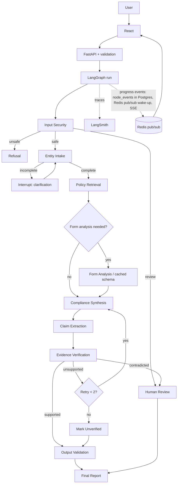
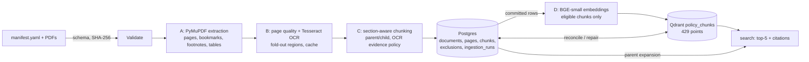

# 01 — Architecture

> This is the planned architecture. For what is actually built at the close of M5 (including what is disabled or not built), see [`docs/handoff/01-architecture-handoff.md`](handoff/01-architecture-handoff.md).

## Layers
| Layer | Responsibility | Tech |
|---|---|---|
| User interaction | UI, report presentation, SSE progress | React + Vite + Tailwind |
| Application | API, sessions, orchestration entrypoint, queue workers | FastAPI, Redis (arq) |
| Intelligence | LangGraph, LLMs, RAG, multimodal, verification | LangGraph, Groq, Gemini, DeBERTa |
| Infrastructure | Relational data, vectors, cache, files, tracing | Postgres, Qdrant, Redis, local/object storage, LangSmith |

The **graph is the orchestrator** (predictable, debuggable, testable) — not free-roaming autonomous agents.

## Request lifecycle


## Workflow lifecycle and retention (M3)
API → in-process run (Postgres lease, checkpoint after every node) → `node_events` in Postgres → SSE (Redis wake-up only) → report (insert-only). Expired sessions are purged by the CLI (`make purge`): phase 1 removes checkpoints and idempotency rows at expiry; phase 2 removes the session, runs and reports after `REPORT_RETENTION_D`. Demo path: `make api`, then `make demo` (or `make demo-live` with the owner's Groq gate).

## Document ingestion (implemented in M1)
Pipeline A runs offline from the CLI (`make ingest`), one document at a time. Postgres is the source of truth; Qdrant is a derived index built from committed rows, and the two are reconciled rather than written in one transaction.

| Module | Role |
|---|---|
| `app/ingestion/manifest.py` | manifest schema rules, PDF existence + SHA-256 |
| `app/ingestion/{pdf,structure,quality,ocr,pages}.py` | Stages A–B: extraction, page quality, OCR fallback |
| `app/ingestion/{cleaning,chunking}.py`, `chunkers/` | Stage C: profile-specific chunkers, parent/child, OCR evidence policy |
| `app/ingestion/prepare.py` | Stages A–C for one document, failures attributed to a stage |
| `app/db/{models,corpus,persistence,repository,runs}.py` | Stage E: schema, row mapping, idempotent writes, reads, run log |
| `app/retrieval/{embeddings,qdrant_store,indexing,search}.py` | Stage D: BGE, Qdrant with bounded backoff, idempotent indexing, filtered dense search |
| `app/retrieval/{reconcile,evaluation}.py` | Postgres ↔ Qdrant reconciliation; Recall@k benchmark (any retriever, with latency) |
| `app/retrieval/keyword.py` | M2 A1: BM25 keyword index built in-process from Postgres rows, filter-before-scoring, version-checked freshness (A2: `xmin`) |
| `app/db/forms.py` (migrations `0003`–`0005`) | M2 C2/G3/G4: persisted, versioned form schemas per (document, method, version). Insert / unchanged / refuse-on-conflict. Database guards against policy obligations and malformed JSON (0004). `gemini_multimodal` method (0005). Method-aware loads (default `m1_chunks`). `load_form_schema_cached`: Redis read-through, with Postgres deciding the current row |
| `app/llm/{common,transport,provider,groq,cache}.py`, `app/core/ratelimit.py` | M3 S1: shared provider errors and validation (`common`); shared retry helpers extracted from Gemini without behaviour change (`transport`); text `LLMProvider` contract with transient-only `FallbackLLMProvider` and `generate_validated` (one re-ask, then degrade); live-gated Groq provider (SecretStr, 30 s timeout, ≤ 2 retries with jittered backoff, JSON-schema output, error bodies never kept); request + token rate limiter shared through Redis with an in-process fallback; opt-in LLM cache for allowlisted synthetic inputs only; scripted `FakeLLMProvider` |
| `app/llm/{multimodal,gemini,fallback,fake}.py` | M2 G1–G3: provider-agnostic `MultimodalProvider` contract, validated structured output; live-gated Gemini provider (SecretStr, 60 s timeout, 5 attempts at 2→4→8→16 s, RPM limiter, RECITATION diagnostics); primary→fallback model on transient exhaustion only; scripted fake for tests |
| `app/forms/{approval,render,pipeline,ocr_fallback}.py` | M2 G1–G3: approved-blank-forms allowlist; hash-verified page rendering; per-page Gemini extraction with one re-ask, corroboration against stored M1 text, page provenance (extractor v2 keeps repeated labels); local Tesseract OCR for RECITATION-refused pages (human review, never fields) |
| `app/core/cache.py` | M2 G4: best-effort Redis JSON cache (short timeouts; failures counted, never raised) |
| `app/forms/extract.py`, `app/schemas/forms.py` | M2 C1: deterministic form schemas from stored M1 chunks (printed labels, `required_as_shown`, OCR kept as flagged text, page/chunk provenance) |
| `app/retrieval/rerank.py` | M2 B1: optional cross-encoder reranking (MiniLM, pinned, CPU, lazy; off by default); raw scores for ordering only |
| `app/graph/{state,routing,builder}.py`, `app/graph/nodes/*.py` | M3 S2: JSON-safe `KYCState` with Pydantic models for every nested value and `validate_state`; the two status vocabularies (`RunStatus`, `Outcome`) and `decide_outcome` precedence; pure, fail-closed routing functions; the graph built with explicit path maps, `GraphDeps` dependency injection and an explicit recursion limit checked against the longest legal path; nine stub nodes (one file each) that make no decisions yet |
| `app/workflow/{runtime,service}.py`, `app/api/v1/sessions.py`, `app/api/errors.py` (migration `0007`) | M3 S6: the workflow API (sessions, messages, resume, retry, reports), the Postgres checkpointer in the `langgraph` schema, run lease and heartbeat, idempotency, the codes-only error envelope, and the screened resume path (the only way a `Command` reaches the graph) |
| `app/graph/{synthesis,validation,report}.py`, `app/db/workflow.py` (migration `0006`) | M3 S5: the synthesis contract and budgeted, delimited prompt; the authoritative output validator (citations re-resolved, uncited items dropped, the MANDATORY gate, never upgraded); one insert-only `ComplianceReport` per run with deterministic messages (the fallback text, failure distinct from no information, the disclaimer); workflow tables |
| `app/graph/{corpus,evidence}.py`, `app/graph/nodes/{policy_retrieval,form_analysis,evidence_association}.py` | M3 S4: read-only `CorpusReader` over the existing repository/forms functions; entity and entity-group retrieval passes with full provenance and the four evidence statuses (`found`/`partial`/`none`/`retrieval_failed`); stored-schema form selection (latest complete Gemini row, else m1; never a live call); deterministic field-evidence relationships (never obligations) |
| `app/security/screen.py`, `app/graph/{inputs,intake}.py` | M3 S3: deterministic input screening (hygiene, narrow injection phrases, identifiers blocked, email/phone redacted; codes only); the gate in front of the graph (`start_input`, `resume_command`); the intake contract (`IntakeExtraction`) and its rules (closed vocabularies incl. `AccountType`, evidence spans, no defaults, structured clarification answers) |
| `app/retrieval/factory.py` | M3 S2: public `retriever_from_settings` (moved unchanged from the CLI; CLI search output verified byte-identical) |
| `app/retrieval/{fusion,retrieve}.py` | M2 A2: RRF fusion; `dense` / `bm25` / `hybrid` modes with provenance, score kinds and degraded results |
| `app/ingestion/{pipeline,cli}.py` | Stage F: per-document orchestration (full / persist / index), dry run, retry, CLI |

Details: docs/04 (pipeline), docs/08 (tables, payload), docs/15 (vocabularies), `docs/milestones/M1_HANDOFF.md` (status and measurements).

## Repo structure
```
agentic-kyc-compliance-engine/
├── CLAUDE.md  README.md  Makefile
├── docs/                      # this spec pack
├── infra/                     # docker-compose.yml, .env.example
├── data/
│   ├── raw_pdfs/              # gitignored; see docs/14-source-corpus.md
│   │   ├── regulatory/  policy/  forms/  reference/
│   │   └── manifest.yaml
│   ├── processed/             # extracted pages, form schemas
│   └── eval/                  # benchmark JSONL
├── backend/
│   ├── pyproject.toml  alembic/
│   └── app/
│       ├── main.py  config.py
│       ├── api/v1/            # sessions, documents, reports, ingestion, health, sse
│       ├── core/              # logging, errors, rate limiter, cache (Redis)
│       ├── db/                # models.py, session.py, repositories
│       ├── llm/               # provider.py (interface), groq.py, gemini.py, fallback.py
│       ├── ingestion/         # policy_pipeline.py, form_pipeline.py, chunking.py, ocr.py, cli.py
│       ├── retrieval/         # embeddings.py, qdrant_store.py, keyword.py, fusion.py, rerank.py
│       ├── rules/             # rule models, loader, applicability engine
│       ├── verification/      # claims.py, nli.py, scoring.py
│       ├── security/          # prompt_guard.py, validators.py, sanitize.py
│       ├── graph/             # state.py, builder.py, routing.py, nodes/*.py
│       └── schemas/           # Pydantic models (API + LLM outputs)
├── backend/tests/             # unit, integration, adversarial
├── eval/                      # runners, metrics, ablation configs
└── frontend/                  # React app (5 screens)
```
