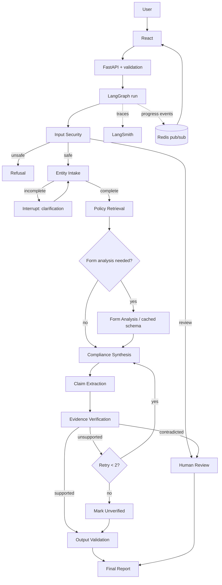

# 01 — Architecture

## Layers
| Layer | Responsibility | Tech |
|---|---|---|
| User interaction | UI, report presentation, SSE progress | React + Vite + Tailwind |
| Application | API, sessions, orchestration entrypoint, queue workers | FastAPI, Redis (arq) |
| Intelligence | LangGraph, LLMs, RAG, multimodal, verification | LangGraph, Groq, Gemini, DeBERTa |
| Infrastructure | Relational data, vectors, cache, files, tracing | Postgres, Qdrant, Redis, local/object storage, LangSmith |

The **graph is the orchestrator** (predictable, debuggable, testable) — not free-roaming autonomous agents.

## Request lifecycle


## Repo structure
```
agentic-kyc-compliance-engine/
├── CLAUDE.md  README.md  Makefile
├── docs/                      # this spec pack
├── infra/                     # docker-compose.yml, .env.example
├── data/
│   ├── raw_pdfs/              # gitignored; see docs/14-source-corpus.md
│   │   ├── regulatory/  policy/  forms/  reference/
│   │   └── manifest.yaml
│   ├── processed/             # extracted pages, form schemas
│   └── eval/                  # benchmark JSONL
├── backend/
│   ├── pyproject.toml  alembic/
│   └── app/
│       ├── main.py  config.py
│       ├── api/v1/            # sessions, documents, reports, ingestion, health, sse
│       ├── core/              # logging, errors, rate limiter, cache (Redis)
│       ├── db/                # models.py, session.py, repositories
│       ├── llm/               # provider.py (interface), groq.py, gemini.py, fallback.py
│       ├── ingestion/         # policy_pipeline.py, form_pipeline.py, chunking.py, ocr.py, cli.py
│       ├── retrieval/         # embeddings.py, qdrant_store.py, keyword.py, fusion.py, rerank.py
│       ├── rules/             # rule models, loader, applicability engine
│       ├── verification/      # claims.py, nli.py, scoring.py
│       ├── security/          # prompt_guard.py, validators.py, sanitize.py
│       ├── graph/             # state.py, builder.py, routing.py, nodes/*.py
│       └── schemas/           # Pydantic models (API + LLM outputs)
├── backend/tests/             # unit, integration, adversarial
├── eval/                      # runners, metrics, ablation configs
└── frontend/                  # React app (5 screens)
```
