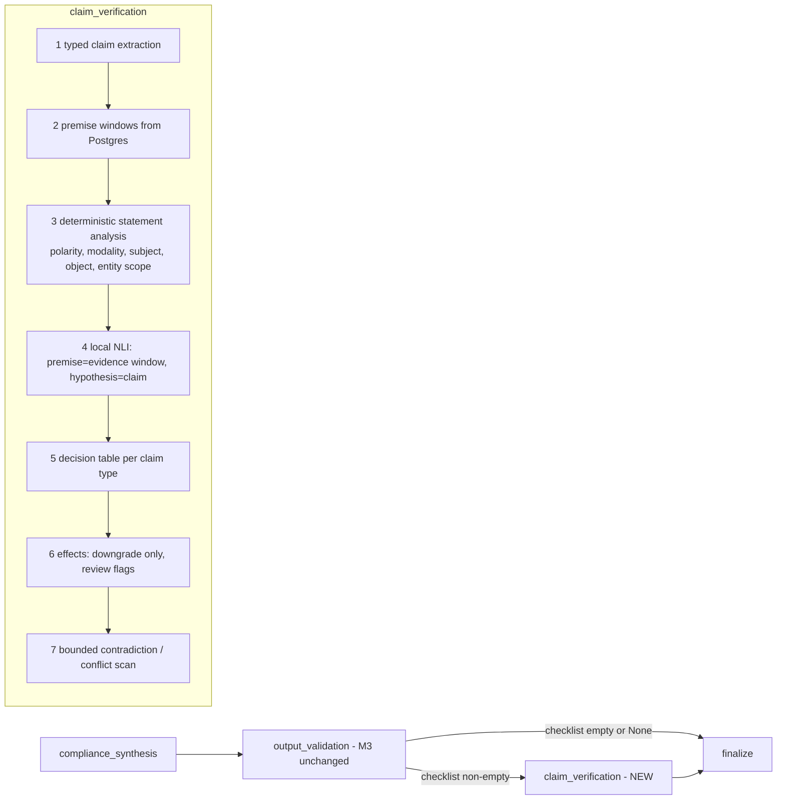

# M4 Plan: Claim Verification and Evidence Validation

> Independent educational prototype. Not an HDFC Bank or RBI system. Every report requires human review.

**Status:** locked by the owner on 2026-11-12 (plan revision 2; decisions D1–D14 approved, §O). Stages run one at a time on stacked branches (`feat/m4-s0-plan` → …), one review and one commit each. **Previous milestone:** [`M3_HANDOFF.md`](M3_HANDOFF.md).

Revision 2 refined: claim typing (R1), deontic/negation analysis (R2), NLI output semantics (R3), contradiction and supersession (R4), review records (R5), evaluation governance (R6).

## A. Current-state audit (unchanged; summary)
- Graph: `input_security → entity_intake ⇄ clarify → policy_retrieval → [form_analysis] → evidence_association → compliance_synthesis → output_validation → finalize`.
- `graph/validation.py::validate_draft`: supplied∩stored citations, uncited items dropped, MANDATORY only on primary ∧ can_support_mandatory ∧ active ∧ entity scope, never upgrades.
- Only `rbi_kyc_directions_2025` is `primary`. RBI FAQ and HDFC FAQ are `dated` → supporting. All forms → supporting. No manifest `supersedes` relation exists today.
- Reusable: `CorpusReader.evidence()` (full Postgres text + parent context), `CrossEncoderReranker` loading pattern, `check_report`, M2 frozen-held-out protocol, scripted-LLM e2e harness.
- Locked already: torch, transformers, sentence-transformers, tokenizers, protobuf. **Not locked: `sentencepiece`.** `NLI_MODEL` setting exists, no revision setting.
- Compatibility constraints: `GET /reports` re-validates stored JSON through `ComplianceReport`; five outcomes are DB-CHECKed; reports are insert-only by trigger.
- Discrepancies (to fix in S0 docs commit): seam placement (docs say before validation); docs/03 regeneration + `human_review` node; docs/15 "enforced in M4" (already M3); docs/12 bundles Prompt Guard/rules into M4; docs/05 "combined confidence"; M3_HANDOFF line 5 merge status; README lines 45/85.

## B. Problem definition (unchanged)
Citation validation (does the page exist and qualify?) ≠ semantic verification (does that text say this?) ≠ regulatory obligation (is it legally required for this customer, by an authoritative current source?). M4 automates the second, tightens the gates for the third, and leaves the final judgement on the third to a human.

---

## C. Architecture (D8 kept: node after `output_validation`)

Modules in `backend/app/verification/`: `claims.py`, `premises.py`, `statements.py` (deontic/negation analysis), `nli.py`, `decide.py`, `conflicts.py`. Node `graph/nodes/claim_verification.py` (sync, under the node timeout). `GraphDeps` gains `nli: NLIScorer | None` and a frozen `VerificationConfig`. No new external calls; no Groq/Gemini call added anywhere.

Failure handling: no scorer / load failure / label-mapping check failure / timeout / pair cap → affected claims `not_verified`, `Degradation(component="verification")`, outcome DEGRADED. Never presented as supported; never "not required".

---

## D. Typed atomic claims (R1)

### D.1 Claim types
| Type | What it asserts | Who can SUPPORT it | Can contribute to MANDATORY |
|---|---|---|---|
| `policy_obligation` | A rule obliges this item for this customer type (MANDATORY), or under a stated circumstance (CONDITIONAL) | **Only** `primary` evidence that is active, `can_support_mandatory`, entity scope | Yes, and only this type |
| `form_request` | A bank form asks for this item | Form evidence (`document_type=form`) | **Never** |
| `supporting_statement` | A non-primary source (dated FAQ, HDFC FAQ) states something about this item | Supporting non-form evidence | Never |
| `explanatory_claim` | A sentence of the model's explanation | Judged against cited evidence; its own deterministic subtype (obligation-bearing or descriptive) caps what it can support | Never on its own |

### D.2 What the requirement actually asserts
The draft item asserts `(name N, proposed applicability A, profile entity E)`. M4 derives the **asserted proposition** from A, not from evidence:
- A = MANDATORY → `policy_obligation(N, E, unconditional)`
- A = CONDITIONAL → `policy_obligation(N, E, conditional)` (condition text, if present in the explanation, is recorded; NLI is not asked to verify an unstated condition)
- A = OPTIONAL → `supporting_statement(N optional)`
- A = UNCLEAR → no obligation proposition; only mention/explanatory claims are checked.

The requirement verdict is computed **against the asserted proposition**. Evidence that supports a different, weaker proposition (e.g., the form asks for N) is recorded as such and never satisfies a stronger one.

### D.3 Hypothesis construction (versioned, no ambiguous "requires or requests")
- One fixed, versioned template per claim type (`CLAIM_TEMPLATES_VERSION`), each asserting exactly one thing. Illustrative only (wording fixed and tested in S2):
  - `policy_obligation`: "{N} must be obtained for a {E-label} customer."
  - `form_request`: "The form asks for {N}."
  - `supporting_statement`: as above per subtype.
- A citation is tested only with the hypothesis matching its evidence role: primary chunks → `policy_obligation`; form chunks → `form_request`; other supporting → `supporting_statement`. A form chunk is **never** scored against the obligation hypothesis, so a form cannot produce obligation support even by NLI error.
- `explanatory_claim`s use the model's **verbatim** sentences (split deterministically, abbreviations protected, capped at 6 per item). Each sentence is classified by S3 analysis as obligation-bearing or descriptive; an obligation-bearing explanation sentence supported only by form/supporting evidence is reported `supported_as_form_request_only` and raises finding `explanation_overstates_source`.
- Template risk (the template wording itself biases NLI) is measured in S4 by comparing template hypotheses with hand-written gold hypotheses on the dev set.

---

## E. Deontic, negation, subject and scope analysis (R2)

Purpose: a deterministic **necessary** condition, never a sufficient one. No keyword ever establishes MANDATORY.

For each premise window `statements.py` produces a `StatementAnalysis`:
- `modality`: `obligation` (shall, must, is required to, mandatory, shall be obtained), `permission` (may, can, optional, at the option of), `conditional` (if, where, in case of, subject to, where applicable), `none`.
- `polarity`: `affirmative` | `negated` (not, no, need not, shall not, not required, exempt, dispensed with, other than, except) | `ambiguous` (double negation, negation and obligation in different clauses, exceptions).
- `object_match`: the requirement's anchor terms (N's significant tokens, acronyms, numbers, form numbers) appear in the **same sentence/clause or its list lead-in** ("the following documents shall be obtained: (a)…").
- `subject`: who is obligated where detectable (the RE/bank, the customer, a named person such as designated partner); recorded, not inferred when absent.
- `entity_scope`: entity terms in the sentence, section heading or chunk tags; mismatch with E (e.g., trust paragraph for an LLP) → `scope_mismatch`.

MANDATORY survives only if **all** hold on the same primary citation: M3 gate ∧ NLI `policy_obligation` supported (§F) ∧ modality=obligation ∧ polarity=affirmative ∧ object_match ∧ no scope_mismatch. Otherwise downgrade to CONDITIONAL or UNCLEAR with a reason code. Negated obligation + object match → contradiction candidate. Ambiguous polarity → never supported; insufficient + review flag.

Tests (S2), each with positive, negative and ambiguous variants written from real corpus sentence shapes (synthetic text in tests, real chunks in eval):
affirmative obligation; "shall not"; "need not"/"not required"; exemption/"except"; "other than"; permission ("may"); conditional ("where applicable", "if"); obligation on a different subject; obligation in list lead-in with object in an item; object in a different sentence; scope mismatch; double negation; keyword present with object absent; table-row text without a verb.
Limitation (documented): rule-based clause parsing misses complex syntax; failures fall to `insufficient`, never to `supported`.

---

## F. NLI output semantics (R3)

- **Ordering:** pairs are `(premise, hypothesis)` = `(evidence window text, claim text)`, the MNLI convention. A unit test asserts the order at the call site; S4 sanity check would catch a swap (asymmetric entailment pairs).
- **Label mapping:** read from the checkpoint's `config.json` `id2label`, never hard-coded. Load fails closed unless the set is exactly {entailment, neutral, contradiction} (case-normalised). S4 adds a load-time **sanity triplet** (three fixed synthetic pairs with obvious entailment / contradiction / neutral); mismatch → `not_verified` + degradation `nli_label_check_failed`.
- **Logits vs probabilities:** the CrossEncoder is constructed with `activation_fn=torch.nn.Identity()` (as the reranker does) so `predict` returns raw logits; M4 applies softmax itself (float64) and stores both `logits` and `probs`, explicitly labelled `softmax_of_logits_uncalibrated`. No temperature scaling or calibration is claimed.
- **Meaning of scores:** uncalibrated model signals used only against dev-selected thresholds. Never displayed or stored as "confidence", never regulatory or legal confidence. Reports say "automated text-support check; not a legal determination".
- **Truncation:** windows built to stay ≤ the model's max length (e.g. 512 tokens incl. hypothesis); if the tokenizer would still truncate, the pair is not scored (`not_verified: window_too_long`) rather than silently truncated.
- **Determinism:** CPU, `torch.inference_mode`, fixed batch size; S4 records repeat-run score equality to a tolerance.
- **Model governance (S0/S4, needs approval before any network access):** for each shortlisted DeBERTa-v3 MNLI checkpoint record: licence from the model card (and base model licence), pinned commit hash (`NLI_MODEL_REVISION`, new setting), file list showing whether `tokenizer.json` (fast tokenizer) is shipped. If only `spm.model` exists, `sentencepiece` is required → separate dependency approval. Weights are downloaded only after approval, to the HF cache, never committed.

---

## G. Decision table and effects
Per (claim, citation): best window by entailment; max contradiction over windows.

| Claim verdict | Rule |
|---|---|
| `supported` | entail ≥ τ_e ∧ contradiction < τ_c ∧ statement analysis compatible with the claim type ∧ evidence role allowed for the type (§D.1) |
| `contradicted` | contradiction ≥ τ_c (or negated-obligation with object match) ∧ no supported window |
| `conflicting` | supported in one citation/window and contradicted in another → review |
| `insufficient` | anything else, including ambiguous polarity, missing anchors, scope mismatch |
| `not_verified` | technical failure, cap, missing scorer |

Requirement verdict vs the asserted proposition: `supported` | `supported_weaker_than_asserted` (e.g., only `form_request` supported) | `partially_supported` (core supported, some explanation sentences insufficient) | `unsupported` | `contradicted` | `conflicting` | `not_verified`.

Effects (never upgrade; enforced by a validator on the output model and property tests):
- MANDATORY → kept only per §E; else CONDITIONAL (`mandatory_not_established`) or UNCLEAR.
- `supported_weaker_than_asserted` → CONDITIONAL at most; label "the form asks for this; no policy obligation verified".
- `unsupported` → removed from checklist into `unverified_items` (D2) with citations and reason.
- `contradicted` / `conflicting` → UNCLEAR, kept visible, review flag.
- `applicability_after ≤ applicability_before` checked for every item.

---

## H. Contradiction and source conflicts (R4)
- **Bounded, not exhaustive:** the scan covers only the evidence already retrieved for this run (supplied chunks), capped at `MAX_CONFLICT_PAIRS`. The report states `contradiction_scan: bounded (n chunks)` and the user message says absence of a detected conflict is not proof that none exists.
- **No resolution by date:** a newer publication or issue date never resolves a conflict.
- **Supersession only with verified evidence:** a source may be treated as superseding another only when the manifest records `supersedes` for that pair, the superseding document is `source_status=active`, and `version_review_status=confirmed`. Today no such relation exists, so **every conflict is reported unresolved**.
- **Visibility:** conflicts (e.g., dated RBI FAQ vs 169MD) produce `conflicting_sources` findings and review cases; both sides' citations stay in the report. The MANDATORY gate is unaffected (it already ignores dated/supporting sources) but the conflict flag is still shown.

---

## I. Schema (minimum)
Pydantic models (frozen, extra=forbid) in `graph/state.py`:
- `AtomicClaim{claim_id, requirement_id, claim_type, asserted_strength: unconditional|conditional|none, text, template_version|None, source_sentence_index|None}`
- `StatementAnalysis{modality, polarity, object_match, subject|None, scope: match|mismatch|unknown, cues: list[str]}`
- `EvidenceJudgement{claim_id, evidence_id, document_key, page, page_end, window_start, window_end, evidence_role, logits[3], probs[3], score_semantics: "softmax_of_logits_uncalibrated", analysis, eligibility, match_scope, text_reliability, source_status}` (metadata copied from Postgres)
- `ClaimVerdict`, `RequirementVerification{…, applicability_before, applicability_after, review_flags}`, `VerificationMeta{status, model_id, model_revision, label_map, templates_version, thresholds_version, pairs_scored, pairs_capped, contradiction_scan_size, timings_ms}`
- Report v2: `report_version` (absent/1 = M3, 2 = M4); widened Literals so **every stored M3 report still validates** (fixture test from a real M3 report shape); new optional fields default to None/empty.
- No `claims` table; claims live in the immutable report JSON.

---

## J. Human-review records (R5; D5 refined)
- Migration `0008_m4_review_cases`: `id` (uuid5 of report_id + requirement_id + reason, so finalize is idempotent), `report_id` FK → reports ON DELETE CASCADE, `session_id`, `run_id`, `requirement_id`, `claim_id` NULL, `reason` (CHECKed codes: contradicted, conflicting_sources, unsupported, mandatory_not_established, explanation_overstates_source, not_verified), `status` CHECK = `'open'` only, `created_at`.
- **No reviewer-decision columns, no decision endpoint, no status transitions in M4.** They arrive with authentication in a later milestone and a later migration. Table is insert-only via trigger (like `reports`).
- Created by `finalize` in the same transaction scope as the report; read-only `GET /api/v1/reports/{id}/review-cases`. Reports stay immutable. Retention cascades with phase 2; `check-workflow` extended.

---

## K. Security and compliance
Local NLI only; zero new external calls; no live Groq/Gemini; synthetic data only; evidence remains untrusted data (classifier, not instruction follower) with an injection-through-evidence fixture; never-upgrade invariant; MANDATORY still requires the M3 gate plus §E; failures are `not_verified`; no prompts, raw model output or user words in state; claim text is the already-stored model prose; disclaimer, `human_review_required=true` and "Decision support only. Not a KYC decision." preserved; the M3 notice "Not claim-verified (M4)" is replaced in v2 reports only.

---

## L. Evaluation (R6)
- **Labelling guidelines first** (`docs/milestones/M4_LABELLING_GUIDELINES.md`, committed in S3 before any label): definitions of entailed / contradicted / insufficient per claim type; that form text never entails an obligation; polarity/exception rules; scope rules; how to label list lead-ins, tables, OCR text and dated sources; worked examples and edge cases.
- **Datasets:** `m4_claims_dev.jsonl` and `m4_claims_heldout.jsonl` (≥15 per gold class per split, all claim types and perturbations: paraphrase, negation, number/entity/document swap, scope widening, form-only, entity-group, OCR-uncertain, dated vs current). Real stored chunk ids; label-integrity test.
- **Provenance per case:** `annotator` (implementing assistant), `owner_review: pending|accepted|changed`, `owner_note`, `second_review: null|{reviewer, verdict}`; disagreements recorded, never overwritten. A summary table in the guidelines doc reports counts.
- **Limitations stated:** single annotator plus owner review is not independent annotation; no inter-annotator agreement is claimed unless a second reviewer exists; small N → wide CIs; labels drafted by the same assistant that builds the system (risk of shared blind spots).
- **Freeze:** held-out SHA-256 pinned by a test; run once in S8. Thresholds and model are chosen in S4 on dev under a pre-registered rule (minimise false-support subject to a supported-recall floor; ties → smaller model) and frozen in config with `thresholds_version`; a test asserts the runtime thresholds equal the committed selection record. Held-out results never retune anything; label errors go to a new versioned file.
- **Metrics:** per-class P/R/F1; false-support rate (primary safety); false-contradiction rate; abstention and risk–coverage; entity-scope errors; obligation-from-form errors (must be 0); mandatory safety invariant (0); deontic/negation subset accuracy; ablation deterministic-only vs NLI vs combined; latency p50/p95 and load time; human-review agreement (raw %, owner only).
- **Regression:** all M3 suites, dense golden, schema, topology (deliberately updated), M3 v1 reports readable, secret scan.

---

## M. Stages (one stage, one review, one commit)
| # | Objective | Main files | Acceptance | Risks |
|---|---|---|---|---|
| S0 | Lock plan; docs discrepancy fixes; model governance record (licence, revision, tokenizer files) after approval of read-only HF metadata access | docs | decisions + model facts recorded | sentencepiece needed |
| S1 | Data model, report v2 with v1 compatibility | `graph/state.py`, tests | M3 suites green; v1 fixture parses | Literal widening |
| S2 | Typed claims, templates, premises, `statements.py`, decision table with fake scorer | `verification/*` | deontic/negation test matrix passes; form never yields obligation | rule coverage |
| S3 | Labelling guidelines, dev + held-out sets, owner review, freeze | `data/eval/m4_*`, guidelines | committed before any NLI run | small N |
| S4 | NLI scorer (label map + sanity triplet, logits/softmax), selection on dev | `verification/nli.py`, `config.py`, eval runner | selection record committed; thresholds frozen | latency, licence |
| S5 | Node after `output_validation`, effects, report v2 | node, builder, routing, report | invariants proven; e2e green with fake NLI | checkpoint compat |
| S6 | Bounded contradiction scan, conflict flags, supersession rule | `verification/conflicts.py` | no date-based resolution; conflicts visible | false contradictions |
| S7 | `review_cases` (open, insert-only), read endpoint, retention | migration 0008, db, finalize, api | check-schema clean; purge cascades | — |
| S8 | Held-out once, ablation, latency, `check_report` M4 rules, real-corpus e2e (scripted LLM, local NLI) | acceptance, tests, docs/10 | results recorded as-is | weak numbers |
| S9 | Docs and handoff | docs, README | DoD met | — |

## N. Out of scope for M4
Prompt Guard, adversarial security suite, rules table (Future security milestone — number TBD, per D1); regeneration loops; LLM-as-judge; reviewer decisions and authentication; frontend review queue; retrieval changes; calibrated confidence; any live Groq/Gemini call; autonomous approval/rejection (never).

## O. Decisions (owner-approved 2026-11-12)
| ID | Decision | Approved choice | Status |
|---|---|---|---|
| D1 | M4 scope | Claim verification + open review cases; Prompt Guard / rules / attack suite → Future security milestone — number TBD | approved |
| D2 | Unsupported items | Out of checklist, visible in `unverified_items` | approved |
| D3 | Regeneration | None in M4 | approved |
| D4 | Scores | Categorical verdicts; logits + softmax stored as uncalibrated signals; no "confidence" | approved (refined, R3) |
| D5 | Review cases | `open`-only insert-only table + read endpoint; no decision fields/endpoint until auth | approved (refined, R5) |
| D6 | NLI model | DeBERTa-v3 MNLI shortlist, chosen on dev by pre-registered rule; pinned revision | approved (refined, R3) |
| D7 | Nothing verified-supported | Keep CHECKLIST_REVIEW_REQUIRED, all items unverified; no new outcome | approved |
| D8 | Placement | After `output_validation` | approved |
| D9 | Claim typing | Four types; asserted proposition from proposed applicability; form evidence never scored against obligation hypotheses | approved (R1) |
| D10 | Supersession | Only manifest `supersedes` + active + `version_review_status=confirmed`; never by date; all current conflicts unresolved | approved (R4) |
| D11 | Network access in S0 | Permit read-only Hugging Face metadata lookups (model card, file list, commit hash) | approved |
| D12 | Weights download in S4 | Permit downloading the shortlisted checkpoints to the local HF cache | approved |
| D13 | `sentencepiece` | Add only if the chosen checkpoint has no fast tokenizer | approved (conditional; S0: likely not needed, confirmed at the S4 load) |
| D14 | Second reviewer | Optional; if none, report states single annotator + owner review only | approved (optional) |

---

## S0 outcome (2026-11-12): plan locked, model metadata recorded
**Model governance (D11, read-only Hugging Face API and `config.json` lookups; no weights downloaded):**

| Checkpoint | Pinned revision | Licence (checkpoint / base) | `config.json` `id2label` | Layers / hidden | `model.safetensors` | `tokenizer.json` |
|---|---|---|---|---|---|---|
| `cross-encoder/nli-deberta-v3-xsmall` | `a150876415327c80daeff35ca6f68f5ed8cf5c24` | Apache-2.0 / MIT (`microsoft/deberta-v3-xsmall`) | 0 contradiction, 1 entailment, 2 neutral | 12 / 384 | 283 MB | yes |
| `cross-encoder/nli-deberta-v3-small` | `fa2804872c3b4bd748f38c0185cc85775361e735` | Apache-2.0 / MIT (`microsoft/deberta-v3-small`) | 0 contradiction, 1 entailment, 2 neutral | 6 / 768 | 568 MB | yes |
| `cross-encoder/nli-deberta-v3-base` | `6c749ce3425cd33b46d187e45b92bbf96ee12ec7` | Apache-2.0 / MIT (`microsoft/deberta-v3-base`) | 0 contradiction, 1 entailment, 2 neutral | 12 / 768 | 738 MB | yes |
| `MoritzLaurer/DeBERTa-v3-base-mnli-fever-anli` | `6f5cf0a2b59cabb106aca4c287eed12e357e90eb` | MIT / (base not declared in card metadata) | 0 entailment, 1 neutral, 2 contradiction | 12 / 768 | 369 MB | yes |

Findings:
- **Label orders differ between candidates.** This confirms §F: the mapping is read from `id2label` at load time and checked with the sanity triplet, never hard-coded.
- **Every candidate ships `tokenizer.json`** (fast tokenizer), so `sentencepiece` is expected not to be needed (D13). This is confirmed only when S4 actually loads a checkpoint with the locked packages; if the load requires it, S4 stops and asks.
- **All have `max_position_embeddings` 512**, matching the window budget in §F.
- The S4 shortlist is these four. Sizes are download sizes, not measured memory or latency; S4 measures those.
- The MoritzLaurer card metadata does not name a base model; its licence (MIT) is recorded from the card. The cross-encoder card statements are recorded from metadata only.

**Docs aligned in S0** (discrepancies in §A): README features/verification text and roadmap, docs/03 (claim_verification placement and routing), docs/05 (verification pipeline per this plan), docs/12 (M4 scope per D1), docs/15 (primary-only MANDATORY already enforced in M3 S5), M3_HANDOFF status line. The `builder.py` seam comment is code and is updated in S5 with the node.

**Milestone numbering (owner decision, 2026-11-12):** the deferred security work is labelled "Future security milestone — number TBD". M5 stays reserved for the frontend (docs/12).

**Checks:** docs-only stage. Unit suite 968/969: the one failure, `test_groq_provider.py::test_live_calls_and_cache_are_off_by_default`, also fails on `main` without these changes. It reads the repo-root `.env`, where `GROQ_DATA_TERMS_VERIFIED_ON` is still set from the M3 live run (`GROQ_LIVE_ENABLED` is already false). Same `.env` dependence as the M3 handoff records; owner action: clear that value in `.env` when no live run is planned.

**Not done in S0:** no application code, no dependency, no weights download, no migration.

## S1 outcome (2026-11-12): claim and verification models, report v2
**Delivered** (`app/graph/state.py`; no graph, node, prompt or migration change):
- **Models:** `AtomicClaim`, `StatementAnalysis`, `EvidenceJudgement`, `ClaimVerdict`, `RequirementVerification`, `VerificationMeta`, `UnverifiedItem`; vocabularies `ClaimType`, `EvidenceRole` (+ `evidence_role()` derived from stored document type and eligibility), `ALLOWED_ROLES`, `NLI_LABELS` (canonical storage order), `RequirementVerdict`, `ReviewReason`.
- **Invariants enforced by the models themselves:**
  - never upgrade: `never_upgraded()` on `RequirementVerification`, and `ValidatedRequirement` can no longer exceed its proposal. `APPLICABILITY_STRICTNESS` is now the single ordering; `validation.STRICTNESS` points to it (same values, no behaviour change);
  - MANDATORY after verification only per §E: a supported, unconditional `policy_obligation` claim whose best evidence is scored, primary, `can_support_mandatory`, active, entity scope, and reads as an affirmative obligation naming the item with no scope mismatch. Weak verdicts can never stay MANDATORY;
  - a form chunk can never be judged for an obligation claim (`ALLOWED_ROLES`);
  - scores: logits and probabilities stored together, 3 finite values each, probabilities in [0, 1] summing to 1, labelled `softmax_of_logits_uncalibrated`; an unscored pair must give a reason;
  - `VerificationMeta`: a run records model id, revision, label map (exactly entailment/neutral/contradiction) and template/threshold versions.
- **State:** `claim_results`, `verification_meta`, `unverified_items` (not input keys, so never caller-settable).
- **Report v2:** `report_version` (default 1), widened `notice`/`verification`/item status Literals, `claim_verification`, `verification_meta`, `unverified_items`. v1 must carry the M3 notice and no M4 field; v2 must be internally consistent (verification label matches meta status; each item is in the checklist or unverified, never both; shown applicability = verified applicability; only `unsupported` items are set aside). M3's `build_report` still produces v1; v2 is produced from S5.
- **`Degradation.component`** gains only `verification`.
- **Compatibility evidence:** 8 committed v1 fixtures (`tests/fixtures/m3_reports_v1/`) captured from the unchanged M3 code before any S1 edit, covering all five outcomes. Each validates as v1 with every stored value unchanged; dumping adds only the four new keys with v1 defaults. Also validated: the local (gitignored) M3 demo and live records, every report stored in the developer database, and raw M3-style rows read back through `PostgresReportStore`. A v2 report passes the existing `reports` CHECKs and insert-only trigger, so **no migration is needed**.

**Checks:**
- Unit: 1113 passed, 1 failed (`test_groq_provider.py::test_live_calls_and_cache_are_off_by_default`, the known `.env` dependence recorded in S0; not a regression). New: `tests/unit/test_m4_models.py` (145 tests).
- Integration: 271 passed, 2 failed, both environmental (below). New: `tests/integration/test_m4_report_compat.py` (6 tests, none skipped).
- ruff, black, strict `mypy app` (112 files), `alembic check` (no drift): clean.

**Environment-dependent failures, not regressions:** `test_dense_golden.py::test_dense_retrieval_reproduces_the_m1_golden_snapshot` and `test_hybrid_dev.py::test_hybrid_on_the_dev_stack_preserves_dense_provenance` both fail on query m1-14 at ranks 2/3. The golden snapshot records an **exact score tie** there (0.676856 for both chunks: the same declaration in `hdfc_nri_account_opening` p.3 and `hdfc_resident_to_nro_conversion` p.3), and Qdrant returned the tied pair in the other order after the containers were restarted for this run. Both tests fail identically on the M3 code with every S1 change stashed. S1 does not touch retrieval. The golden tests were not changed: making their tie handling deterministic (e.g. comparing tied hits as a set, or a chunk-id tie-break) is a separate owner decision.

## S2 outcome (2026-11-12): deterministic verification foundation
**Delivered** (`backend/app/verification/`; not wired into the graph, no real model, no dependency, no migration):
- `text.py`: segmentation with exact character offsets. Splits on sentence ends, `;`, `:` (list lead-ins) and list markers; never on "Form No. 60", "Rs.", "e.g.", "16.1", "10:30". Paragraph labels ("35.", "Q6.") and connectors ("and") stay with their text.
- `premises.py`: premises from the **stored** evidence context (Postgres text, not the truncated state copy). Windows are single segments, adjacent pairs, and a list lead-in through each item of its sentence. `content[start:end] == window` always; a child chunk is read in its parent paragraph and `window_chunk_id` names the parent. Bounded (1000 chars per window, 40 windows per premise, cap reported). A citation that disagrees with the stored chunk raises `PremiseMismatch`.
- `statements.py`: modality (obligation / permission / conditional / none), polarity (affirmative / negated / ambiguous: double negation, exceptions, stray negators), anchors (numbers and acronyms strict, "60/61" as alternatives; other words at least half; entity-type words do not identify an item; no synonyms), subject (recorded only when named; person-role conflicts detected), entity scope (window, then section heading). A necessary condition only.
- `claims.py` (templates `t1`): the asserted proposition from the PROPOSED applicability (MANDATORY → unconditional `policy_obligation`, CONDITIONAL → conditional; OPTIONAL/UNCLEAR → none), kept even when no primary source is cited, so it must fail. Role-specific `form_request` / `supporting_statement` claims for the roles actually cited. Explanation sentences verbatim (max 6; over-long ones counted, not lost). No template uses "requires or requests".
- `nli.py`: `NLIScorer` protocol (`NLIPair(premise, hypothesis)`, canonical label order, raw logits → `softmax` here), `NLIError`, and `FakeNLI` (scripted, records calls). No real model.
- `decide.py`: the decision table. A window supports only with entailment ≥ threshold **and** a compatible reading. It contradicts when it names the item and either the model contradicts or it states the obligation negated. Claim verdicts: conflicting / supported / contradicted / insufficient, and `not_verified` for any unscored allowed pair (no scorer, failure, pair cap). The requirement verdict is judged against the asserted proposition. Effects: `min(before, cap)`; MANDATORY also needs `state.mandatory_established`. Flags: unsupported, contradicted, conflicting_sources, not_verified, mandatory_not_established, explanation_overstates_source. Thresholds are required inputs (no defaults in code; `entail + contradict > 1`).

**S1 adjustments (justified, backward compatible):**
- `mandatory_established` is public, so the decision table and the model validator use one rule.
- `EvidenceJudgement.window_chunk_id` (optional) makes offsets unambiguous for child chunks.
- `RequirementVerification` may hold zero claims (an item asserting nothing checkable, e.g. UNCLEAR citing only primary text), and is then only ever `not_verified`.

**Tests** (unit, no network; property-style tests use seeded `random`, since `hypothesis` is not a project dependency):
- `test_m4_text.py`: 12 tests, including 500 random texts for offset exactness.
- `test_m4_statements.py`: 61 tests, including positive, negative and ambiguous obligation statements.
- `test_m4_premises_claims.py`: 23 tests.
- `test_m4_decide.py`: 33 tests, including a 300-case seeded sweep with random evidence, applicabilities, scope, hashed scores, scorer failure and caps. It asserts never-upgrade, MANDATORY only when established, forms never judged for obligations, nothing supported without scores, JSON round trip and determinism.
- `test_m4_models.py`: 147 tests (S1 suite, updated for zero-claim items).

**Checks:**
- Unit: 1244 passed, 1 failed (the known `.env`-dependent `test_live_calls_and_cache_are_off_by_default`).
- Integration (relevant subset): `test_m4_report_compat`, `test_m3_e2e`, `test_graph_s5_corpus`, `test_workflow_tables`, `test_graph_checkpoint_postgres`, 21/21 passed.
- ruff, black, strict `mypy app` (118 files), `alembic check`: clean.
- The full integration suite was not rerun: S2 adds no graph, retrieval or database code. The two known Qdrant tie failures (S1 outcome) are unchanged baseline issues.

**Limitations found and kept visible (to measure in S3/S4, not tuned now):**
- Anchor matching does no stemming beyond plurals ("attach" ≠ "attached") and no synonyms ("PAN" ≠ "permanent account number"). Both fail towards `insufficient`, never towards `supported`.
- Clause scope is approximated by cue words, so a negator elsewhere in a window makes it `ambiguous`.
- "may be dispensed with" reads as a negated permission. That is still never an affirmative obligation.

## S3 outcome (2026-11-12): golden claim datasets
**Delivered** (data and tests only; no application code, no model run, no threshold, no dependency, no external call):
- `docs/milestones/M4_LABELLING_GUIDELINES.md`, committed with the data and before any NLI run. It covers:
  - the three labels and ten rules, including numbers, modality, lists, conditions, entity/subject, dated sources, OCR, forms, and `expected_obligation` (rule 10);
  - fields, the perturbation vocabulary and examples for every class;
  - split and leakage controls, limitations, and the owner-review procedure (dev reviewed in place; held-out via a separate ledger, so the frozen file never changes).
- `data/eval/m4_claims_dev.jsonl`: 51 cases, 17 per class. Claim types: 25 policy_obligation, 11 explanatory, 9 supporting, 6 form_request. 9 cases expect an obligation. 23 chunks from 5 documents.
- `data/eval/m4_claims_heldout.jsonl`: 51 cases, 17 per class. Claim types: 25 / 13 / 6 / 7. 10 cases expect an obligation. 28 chunks from 6 documents. **SHA-256 `eee0a575319d7df4bc3d8f5c0771a89e4c8bf9f68abe36eb56fcac3275d90203`** (LF), also recorded in docs/10.
- Coverage (dev / held-out case counts):

  | Tag | Dev | Held-out |
  |---|---|---|
  | negation | 7 | 7 |
  | polarity_flip | 6 | 5 |
  | number_change | 8 | 8 |
  | acronym_variant | 12 | 18 |
  | entity_swap | 3 | 3 |
  | scope_widening | 5 | 3 |
  | form_only | 6 | 7 |
  | entity_group | 1 | 1 |
  | ocr_uncertain | 3 | 2 |
  | source_status | 9 | 6 |
  | document_swap | 7 | 7 |
  | paraphrase | 5 | 8 |
  | subject_swap | 1 | 1 |
  | condition_dropped | 1 | 1 |
  | modality_change | 0 | 3 |
  | verbatim_fact | 1 | 0 |

- Cross-source conflict kept visible: the dated HDFC FAQ accepts a telephone bill up to 3 months old (`m4d-032`, contradicted against a two-month claim); the dated RBI FAQ says two months for utility bills (`m4d-013`, entailed). Neither is resolved by date.

**How the files were built:**
- A one-off script (not committed) copied `document_key` and `page` from Postgres and refused any quote that was not an exact substring of the stored chunk. The committed JSONL is the artifact.
- Four labels were corrected during self-review, before freezing, to follow the written rules (numbers on the same quantity; "may" vs an express "may not"; one ambiguous scope case replaced; one quote moved to the sentence that limits small accounts to individuals).

**Tests:**
- `tests/unit/test_m4_datasets.py`, 17 tests: frozen hash, canonical JSONL, fields and vocabularies, ≥ 15 per class, required coverage in both splits, rule 10, no shared chunks, no near-duplicates (max Jaccard 0.786 < 0.8), no duplicates.
- `tests/integration/test_m4_dataset_labels.py`, 205 tests: Postgres provenance and quotes, the database-checkable tags, eligibility of obligation cases, and role/status/reliability coverage.

**Owner action before S4:** review the dev labels (`owner_review`) and, optionally, the held-out labels via the ledger.

**Limitations:** see the guidelines §7. A single annotator, who also built the verifier; small N; synthetic claims; thin entity-group coverage (1 per split); no dev `modality_change` case.

## S3 owner review of the dev set (2026-11-12; uncommitted, awaiting owner approval)
**Review:** all 51 original dev cases were reviewed by the owner from a generated report (exact stored evidence, MANDATORY reasoning, guideline check per case).
- **Decisions:** recorded in `data/eval/m4_claims_dev_review.jsonl`, 19 entries: 12 case-change entries (11 cases), 3 additions and 3 rule clarifications plus 1 modality decision. Each entry holds the owner's words and the previous and applied values.
- **Case decisions (claims unchanged):**
  - m4d-010 and m4d-005 → `insufficient` (dropped provisos, which the verifier must not repair; the provisos are now in the quotes);
  - m4d-016 and m4d-033 → `insufficient` (OCR does not establish the meaning);
  - m4d-031 and m4d-032 → `insufficient` under revised rule 3. m4d-032 stays the cross-source conflict example with m4d-013; no source is selected.
- **Rule 10 (entity scope):** m4d-007, 008, 011 and 012 → `expected_obligation: false` (entity-null; FPI evidence is not generalised). m4d-005 is false through its relabel.
- **Rule 1 (abbreviations):** m4d-012 and m4d-029 now also cite the paragraph 49 heading "Foreign Portfolio Investors (FPIs)" (chunk `9b04e1c1…`, dev-only), so the expansion is established by the source.
- **Additions:**
  - m4d-052 `insufficient` (may vs must);
  - m4d-053 `contradicted` (not mandatory / voluntary vs must, same subject and condition);
  - m4d-054 `entailed` control (no fresh CDD needed). Not counted as a modality example.
- **Result:** 54 dev cases, 15 / 15 / 24.
  - Every reference, quote and tag was revalidated against Postgres (211 checks).
  - The held-out file is byte-identical, SHA-256 `eee0a575…d90203`.
- **Round 2 (owner decisions):**
  - m4d-004 → `insufficient`, claim unchanged ("MoA and AoA" is not established by the source; no terminology mapping is approved).
  - Replacement **m4d-055** (`entailed`, company): "For opening an account of a company, the bank shall obtain the names of the relevant persons holding a senior management position." Its wording is verbatim from paragraph 33 item (6), a dev-only chunk.
  - The other 39 cases are recorded as accepted with their existing labels. The ledger states that this is not an independent re-annotation.
- **Final dev set:** 55 cases, 15 / 15 / 25, owner review complete.
  - **Dev ledger:** 60 entries: 13 case changes (12 cases), 4 additions, 39 acceptances and 4 guideline decisions.
  - **Held-out issues ledger:** `data/eval/m4_claims_heldout_review.jsonl`, 6 entries, status `deferred_to_S8_versioned_correction`.
- **Held-out cases the revised rules would affect (logged in the held-out ledger, not edited; the correction is a separately versioned file at S8):**
  - rule 10: m4h-007, 009, 010, 011 (entity-null with `expected_obligation: true`);
  - rule 1: m4h-008 ("Rs." vs "₹"), m4h-007 ("Form No. 60" vs "Form 60" in the cited chunk), m4h-022 (relies on "One Lakh" = 1,00,000);
  - rule 3: none (every held-out numeric contradiction is mutually incompatible).

## S4.1 outcome (2026-11-12): NLI scorer, dev evaluation and the registered selection rule (no model run)
**Delivered** (no model downloaded or run, no dependency, no graph change, held-out not read):
- `app/verification/nli.py`:
  - `CrossEncoderNLI`: lazy, CPU, pinned 40-hex revision, raw logits with an identity activation;
  - the label-map permutation to canonical order fails closed on any other label set;
  - the fixed sanity triplet runs at load and is recorded;
  - pairs reach the model as (premise, hypothesis);
  - over-long pairs return `None` (never truncated);
  - `nli_from_settings` returns no scorer unless a model and its revision are configured.
- **Protocol change (D4):** `NLIScorer.score` returns `list[NLIScore | None]`, and `decide._score` records `window_too_long`.
- `decide.judge_claim`: the S2 judgement for one claim, exposed for evaluation (no logic copied).
- `app/verification/evaluation.py`:
  - dev-only loader (refuses the held-out set);
  - premises from stored chunks;
  - a cached scorer (each pair scored once per model);
  - exact metrics: per-class precision/recall/F1, false-support and false-contradiction rates, abstention, coverage, MANDATORY false positives/negatives, obligation-from-form errors, per-perturbation accuracy;
  - the three ablations.
- `app/verification/selection.py`: the registered rule (candidates N1–N4, 35-pair grid, gates, the 2/40 cap, objective, tie-breaks), the write-once record and the runtime threshold loader.
- `app/verification/cli.py` and Makefile targets `nli-check`, `eval-claims`, `eval-claims-select`, `test-nli`. The pytest marker `nli` is excluded from `make test`.
- **Settings:** `NLI_MODEL_REVISION`, `NLI_BATCH_SIZE`, `NLI_MAX_PAIRS`, `NLI_SELECTION_RECORD` (thresholds are not settings).

**Decided before any run (with tests):**
- **D3:** "may" idioms are neither permission nor obligation.
- **Claim-framing words are never anchors.** Found while testing the evaluator: dataset claims have no item name, so words like "form", "asks" and "obtained" became required anchors and form-request claims could never match. This changes S2 anchor matching for every caller; all S2 tests still pass.

**Tests:**
- `test_m4_nli.py` (30, fake CrossEncoder): all six label orders, fail-closed maps, a swapped map caught by the sanity triplet, pinning, ordering, over-long pairs, cache, settings.
- `test_m4_evaluation_selection.py` (31): dev-only refusal, claim building for all 55 cases, modes, exact metric arithmetic, every gate, the cap boundary, every tie-break, write-once, the loader.
- New statement and decision tests.
- `test_m4_evaluation_dev.py` (integration): the harness on all 55 stored cases without a model; false-support rate 0 and MANDATORY false positives 0.
- `test_m4_nli_live.py` (marker `nli`): skipped until S4.2 caches a model; runs offline, never downloads.

**Next (S4.2, after owner approval):** download the four pinned checkpoints (D12), `make nli-check`, one `make eval-claims-select`, commit the record and summary.

## S4.2 outcome (2026-11-12): one registered dev run; no configuration qualified. S4 complete.
- **Downloads and load checks.** The four pinned checkpoints were downloaded to the local HF cache (never committed). `make nli-check` passed for all four: label map read from config, sanity 3/3. `sentencepiece` was not needed (D13). `pytest -m nli`: 4 passed, offline.
- **Selection.** `make eval-claims-select` was completed once at `0c4cc49`. A first attempt crashed after scoring because of a CLI path bug, wrote nothing and showed no outcome. Fixed in `0c4cc49`, with no change to the protocol.
- **Outcome (official, owner-accepted):** 0 of 140 configurations qualified.
  - Every configuration failed the MANDATORY false-positive gate (N1: 2; N2–N4: 3, at every threshold pair) and the determinism gate (N1–N3: 3–6e-6; N4: 1.07e-2, against 1e-6).
  - **No NLI model is selected; NLI stays disabled by default** (D5). `infra/.env.example` is unchanged: no model is pinned.
- **Cost.** N4 (float16 on the CPU) takes p50 1.88 s and p95 2.78 s per pair, 53 min for its part of the run, and is estimated at about 36 s per case (typical) and 18.5 min per request at the 400-pair cap (conservative). Total S4.2 compute: 62.4 min plus 65.6 min for the crashed attempt. The full tables are in docs/10.
- **MANDATORY false-positive diagnosis** (read-only rule trace; the details are in docs/10). The upper bound is 7 dev cases (m4d-004, 008, 011, 019, 020, 024, 052). Sources:
  - the gate does not encode labelling rule 10 (no entity → no obligation), behind m4d-008 and m4d-011;
  - window-level instead of sentence-level modality and polarity (m4d-052, m4d-024);
  - the claim's own polarity is not part of the gate (m4d-019);
  - labelling rule 1 for abbreviations cannot be seen by the gate (m4d-004).

  Per-model attribution is not recoverable from the v1 record without re-scoring.
- **Integrity.** The dev SHA in the record equals the committed file. The held-out file is byte-identical (hashed only). The record and summary are committed as produced. No threshold change, relabelling, new protocol or dependency.
- **Consequence for S5.** The graph node ships with NLI off: claims are `not_verified`, with the `verification` degradation and the DEGRADED outcome. The never-upgrade invariant holds. Any later protocol is a new version, disclosed as post-hoc, and needs the owner's approval.

## S5 outcome (2026-11-12): `claim_verification` in the graph, NLI disabled
**Graph** (`builder.py`, `routing.py`):
- `output_validation -> claim_verification | finalize` (`route_after_validation`): only a non-empty validated checklist is verified; a missing, empty or malformed checklist finalizes as in M3. Then `claim_verification -> finalize`.
- The longest path gains one node: `_FIXED_PATH_NODES = 9`, required recursion limit 10/13/16 for 0/1/2 clarification rounds (the default 25 is unchanged).
- The topology change is snapshotted in `tests/fixtures/m4_graph_topology.json`. A test proves the only difference from the M3 snapshot is the planned node and its three edges.

**Dependencies:**
- `GraphDeps` gains `nli`, `nli_thresholds` (both or neither) and `nli_max_pairs`.
- `from_settings` never builds, loads or calls an NLI model, whatever `NLI_MODEL` says; this is tested with `CrossEncoderNLI` and `nli_from_settings` patched to raise.
- No model was downloaded or run in S5. No dependency was added.

**Node** (`graph/nodes/claim_verification.py`):
- Claims are extracted per item (`claims.extract`; roles from the stored chunks).
- **NLI disabled (default):**
  - every claim is `not_verified` with reason `nli_not_configured` (`decide.not_verified_requirement`);
  - there are no judgements, nothing is scored, and no rule-based reading is applied (a negated explanation is NOT turned into a contradiction);
  - applicability is lowered to at most CONDITIONAL, flag `not_verified`;
  - `VerificationMeta.status = not_configured`;
  - `Degradation(component="verification", reason="nli_not_configured")` → outcome DEGRADED.
- **With a scorer (tests only, `FakeNLI`):**
  - premises are built from the stored chunks and judged with `verify_requirement`;
  - an unbuildable premise → that item is `not_verified`;
  - a corpus failure → status `failed`, every item `not_verified`, degradation `corpus_unavailable:<class>`.
- The M3 checklist in state is never modified.

**Report** (`graph/report.py`):
- A report is v2 when the stage ran (`NOTICE_V2`, `verification` mapped from the status, `verification_meta`, `claim_verification`).
- Checklist items show `applicability_after` and their requirement verdict. Citations, names, explanations, form links and proposed applicability are unchanged; the M3 applicability is `applicability_before`.
- `unsupported` items move to `unverified_items` (D2), never "not required".
- New unresolved codes: `claims_not_verified:<n>` and `applicability_lowered_by_verification:<id>`.
- The NLI-off message says checking is not enabled, that this is not a finding that any item is wrong or unsupported, and that sources and pages are unchanged.
- Reports from paths where the stage did not run (blocked, missing information, no evidence, nothing surviving validation, failed synthesis) stay v1, exactly as in M3. Stored v1 reports still validate.
- **Acceptance:** `check_report` accepts `NOTICE_V2` only on a v2 report (M3 notice for v1). The other M3 checks are unchanged. The M4-specific `check_report` rules remain for S8.

**Tests:**
- New: `tests/unit/test_m4_graph_s5.py` (23). It covers:
  - NLI-disabled behaviour: not_verified, nothing scored, no contradiction, MANDATORY never established, never upgraded for every proposed applicability;
  - DEGRADED with the M3 results kept;
  - the v2 report and message;
  - M3 gaps kept;
  - form evidence never bearing an obligation;
  - no model built from settings;
  - GraphDeps validation;
  - unchanged v1 paths;
  - the scripted-scorer path (ran / contradicted / unsupported → unverified item);
  - corpus failure;
  - acceptance and the v1 builder.
- Deliberately updated for the planned behaviour change, each keeping its M3 assertion on the M3 result:
  - unit: graph builder path and recursion limit, routing coverage, the S4 LLP end-to-end, the S5 report test (its privacy check now strips only template claim texts, asserted to be template output), the S1 v1-builder test;
  - integration: `test_graph_s5_corpus`, `test_m3_e2e`, `test_workflow_api`, `test_workflow_events` (the Redis-down run must add no degradation beyond `verification`), `test_workflow_recovery`. Their outcome is now DEGRADED with only the `verification` degradation, and the M3 MANDATORY basis is checked through `applicability_before`.

**Deferred, not fixed in S5** (from the S4.2 diagnosis; any fix needs a separately approved, versioned protocol):
- the MANDATORY gate does not encode labelling rule 10 (no entity → no obligation);
- modality and polarity are analysed per window, not per sentence naming the item;
- the claim's own polarity is not part of the MANDATORY gate;
- labelling rule 1 (abbreviations) is invisible to the gate;
- the determinism tolerance is tighter than float32 batch noise;
- N4 runs in float16 on the CPU.

These do not affect S5 behaviour: with NLI disabled, no claim can be supported, so the gate never sees a supported claim.

**Next (S6, after owner approval):** the bounded contradiction / conflict scan.

## S5 follow-up (2026-11-12): `check_report` validates the report before any rule
Approved by the owner after the S5 review (point 3); no graph, dataset, threshold or NLI change.
- `app/workflow/acceptance.check_report` first runs `ComplianceReport.model_validate`. A failing report returns only `report_schema_invalid` plus `report_schema_invalid:<field location>` codes (never values), and no other check runs. A malformed or internally inconsistent v2 report therefore cannot pass on its version number.
- **Explicit acceptance rules for a v2 report with `verification_meta.status == not_configured`:**
  - every checklist item is `not_verified`, and none is MANDATORY;
  - the metadata names no model, revision, label map or thresholds, and scored nothing;
  - `verification == not_claim_verified`;
  - claim results are present for a shown checklist, and none is verified;
  - there are no unverified items;
  - a `verification` degradation is present and the outcome is DEGRADED.
- **M3 v1 behaviour is unchanged.** The old and new `check_report` give identical results on all 8 stored v1 fixtures, with both a resolving and an empty chunk lookup. A pre-existing M3 rule result is recorded, not changed: the retrieval-failure v1 report gets `fallback_text_missing`.
- **Tests:** `tests/unit/test_m4_acceptance.py` (28):
  - malformed v2 reports (10 kinds);
  - locations never values;
  - a forged not_configured report that passes every model invariant but is caught by the M4 rules;
  - inconsistent metadata, a missing degradation and a non-DEGRADED outcome, each on its own;
  - all v1 fixtures;
  - the v1 rules.

  One S5 assertion in `test_m4_graph_s5.py` now expects `report_schema_invalid` (stricter) for a version/notice mismatch.
- **Not done here (S8, unchanged):** the broader M4 `check_report` rules for reports whose check ran.
